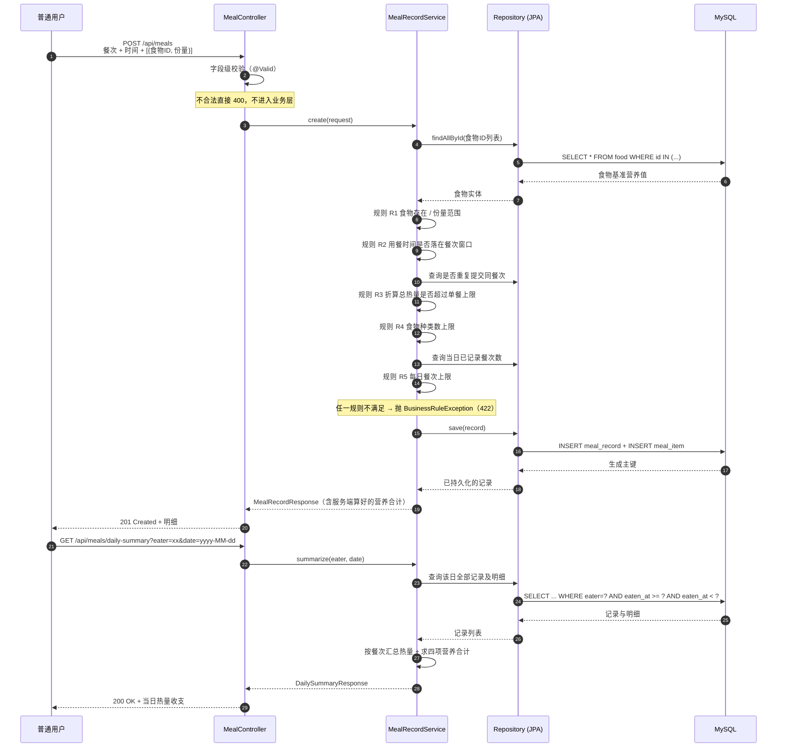
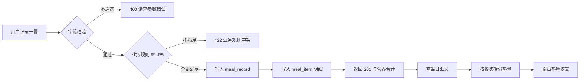
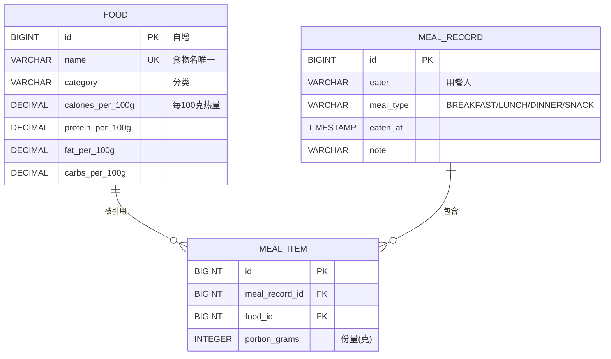
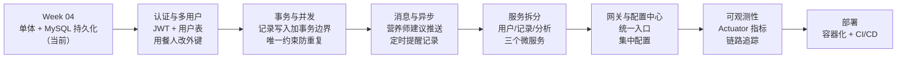

# 个人健康饮食记录管理系统 (Health & Diet Tracker)

> 课程：微服务实践 · 学号 2412190233 · 姓名 郑俊豪
> 仓库：<https://github.com/你的用户名/microservices-practice-2412190233>
> 当前进度：Week 02 选题与功能规划 → Week 03 Spring Boot 工程起步 → **Week 04 业务建模 + REST 接口 + MySQL 持久化**

---

## 目录

- [一、项目简介](#一项目简介)
- [二、业务背景](#二业务背景)
- [三、目标用户与需求](#三目标用户与需求)
- [四、功能模块划分](#四功能模块划分)
- [五、核心业务流程](#五核心业务流程)
- [六、技术栈与运行方式](#六技术栈与运行方式)
- [七、数据库设计](#七数据库设计)
- [八、REST 接口一览](#八rest-接口一览)
- [九、业务规则（Week 04 重点）](#九业务规则week-04-重点)
- [十、可直接运行的 curl 示例](#十可直接运行的-curl-示例)
- [十一、项目范围与暂不实现的内容](#十一项目范围与暂不实现的内容)
- [十二、后续演进方向](#十二后续演进方向)
- [十三、仓库结构](#十三仓库结构)

---

## 一、项目简介

个人健康饮食记录管理系统是一个帮助用户科学管理日常饮食与体重目标的全栈应用。
用户记录每餐吃了什么、多少克，系统按食物库的营养数据自动折算热量与三大营养素，
并给出当日热量收支汇总，让"今天吃多了还是吃少了"这件事有数字可依。

本仓库是**本学期持续演进的唯一课程项目**：Week 02 完成选题与功能规划，
Week 03 建立可运行的 Spring Boot 工程，Week 04 实现第一条完整业务流程并接入 MySQL。
后续周次将在同一工程上继续加入认证、服务拆分、消息、事务、监控与部署。

## 二、业务背景

**要解决的实际问题**：热量摄入与消耗的平衡是体重管理的核心，但普通人很难凭感觉判断
"这一餐大概多少热量"。市面上的健康 App 要么功能繁杂、要么把营养计算放在付费墙后，
用户往往记录几天就放弃。

**本项目的定位**：轻量、免费、数据自己掌握。核心只做三件事——
**记录得足够快**（一条命令/一个请求即可完成一餐记录）、
**算得足够准**（营养值基于统一的食物库基准数据，口径一致）、
**看得懂**（当日汇总直接给出总热量与各餐次占比）。

**为什么这个题目适合演进**：它天然包含"用户 → 记录 → 统计"的清晰边界，
既有主数据（食物库）又有业务数据（饮食记录），
既需要写事务（记录一餐）又需要读聚合（日报表），
后续要加的认证（多用户）、消息（营养师建议推送）、服务拆分（记录/分析/用户三个服务）
在这个场景里都有真实的落脚点，不需要为了用技术而硬造需求。

## 三、目标用户与需求

| 用户角色 | 核心需求 | 当前状态 |
| :--- | :--- | :--- |
| **普通用户**（主要用户） | 快速记录三餐与加餐、查看每餐热量与营养、查看当日汇总、设定减脂/增肌目标 | Week 04 已实现记录与查询、当日汇总；目标设定待后续周次 |
| **营养师**（可选角色） | 查看用户饮食数据、给出饮食建议、制定个性化食谱 | 仅预留角色概念，功能未实现 |
| **管理员** | 维护食物库（热量与营养成分）、维护运动库、管理用户账号、系统监控 | 食物库现阶段由 `data.sql` 预置；增删改与监控待后续周次 |

## 四、功能模块划分

```mermaid
flowchart TD
    ROOT[个人健康饮食记录管理系统]

    ROOT --> M1[用户与认证]
    M1 --> M1a[注册登录 JWT]
    M1 --> M1b[个人档案 身高体重年龄目标]
    M1 --> M1c[角色权限 用户/营养师/管理员]

    ROOT --> M2[食物库]
    M2 --> M2a[按名称检索]
    M2 --> M2b[按分类筛选]
    M2 --> M2c[营养基准值 每100克]

    ROOT --> M3[饮食记录]
    M3 --> M3a[三餐与加餐记录]
    M3 --> M3b[食物与份量明细]
    M3 --> M3c[自动折算热量与三大营养素]
    M3 --> M3d[按人按日查询]

    ROOT --> M4[报表与分析]
    M4 --> M4a[当日热量汇总]
    M4 --> M4b[分餐次热量拆分]
    M4 --> M4c[营养素摄入比例]
    M4 --> M4d[周月趋势]

    ROOT --> M5[身体数据]
    M5 --> M5a[体重 体脂 腰围]
    M5 --> M5b[变化趋势图]
    M5 --> M5c[目标体重与截止日]

    ROOT --> M6[消息提醒]
    M6 --> M6a[定时提醒记录]
    M6 --> M6b[目标达成通知]
    M6 --> M6c[营养师建议推送]
```



> 说明：这里用 `flowchart` 而不是 `mindmap`。GitHub 的 Mermaid 渲染器目前不支持
> `mindmap` 语法，会直接显示成代码块，因此按作业"图表应能在 GitHub 页面正常渲染"的要求，
> 统一选用 `flowchart` / `sequenceDiagram` / `erDiagram` 这些 GitHub 稳定支持的图表类型。

各模块的**具体功能**与当前实现状态：

| 模块 | 具体功能 | Week 04 状态 |
| :--- | :--- | :--- |
| **用户与认证** | 注册/登录（JWT）、个人档案、角色权限 | 未实现；记录中的"用餐人"先用字符串标识 |
| **食物库** | 名称检索、分类筛选、营养基准值（每 100 克） | ✅ 检索与筛选已实现（`GET /api/foods`） |
| **饮食记录** | 记录一餐（含多种食物与份量）、查询本人记录、查询单条明细 | ✅ 已实现（`POST/GET /api/meals`） |
| **报表与分析** | 当日总热量、分餐次拆分、营养素合计 | ✅ 当日汇总已实现；周/月趋势与饼图待后续 |
| **身体数据** | 体重/体脂/腰围记录、趋势图、目标体重 | 未实现（库表设计中已预留思路） |
| **消息提醒** | 定时提醒、目标达成通知、建议推送 | 未实现（对应后续"消息"课程任务） |

## 五、核心业务流程

**主流程：记录一餐并查看当日热量收支**（Week 04 实现的那条完整链路）



**业务流程图**（与上图等价的简化视图，便于快速理解）



## 六、技术栈与运行方式

### 6.1 环境要求

| 项目 | 版本 | 说明 |
| :--- | :--- | :--- |
| JDK | **25** | 课程要求；本机验证版本 25.0.4.1 |
| Spring Boot | **4.0.8** | 课程要求 4.0.x |
| Maven | 3.9.16（自带 Wrapper） | 用仓库内的 `./mvnw`，无需预装 Maven |
| 数据库 | **MySQL 8.x** | 正式运行使用；建库脚本见 `src/main/resources/schema.sql` |
| 内存库（可选） | H2 2.4.240 | 仅用于测试与 `demo` 演示 profile |

### 6.2 数据库准备（MySQL）

```sql
-- 1) 建库
CREATE DATABASE health_diet DEFAULT CHARACTER SET utf8mb4 COLLATE utf8mb4_unicode_ci;
```

```powershell
# 2) 建表 + 灌入示例数据（两个脚本都是可重复执行的，重跑不会重复插入）
cd monolith
mysql -u root -p health_diet < src/main/resources/schema.sql
mysql -u root -p health_diet < src/main/resources/data.sql
```

连接信息在 `monolith/src/main/resources/application.yml`，口令通过环境变量注入，
**不把明文口令提交到公开仓库**：

```powershell
$env:MYSQL_USERNAME = "root"        # 默认 root
$env:MYSQL_PASSWORD = "你的口令"     # 默认空字符串
```

### 6.3 启动与测试

```powershell
cd monolith

# 运行测试（75 个，使用 H2，不需要 MySQL）
./mvnw test

# 启动应用（连 MySQL，端口 8080）
./mvnw spring-boot:run

# 若本机暂时没有 MySQL：用 demo profile 直接跑起来看接口效果
$env:SPRING_PROFILES_ACTIVE = "demo"
./mvnw spring-boot:run
```

> **关于端口**：默认 `8080`。如需修改，改 `application.yml` 里的 `server.port`，
> 并同步修改本文档的 curl 示例。

### 6.4 两个基础接口

| 接口 | 地址 | 用途 |
| :--- | :--- | :--- |
| 问候/运行状态 | <http://localhost:8080/api/hello> | 确认应用已启动，返回项目名与服务器时间 |
| 健康检查 | <http://localhost:8080/actuator/health> | 返回 `{"status":"UP"}`，含数据库连通性 |

```powershell
curl.exe http://localhost:8080/api/hello
# {"application":"health-diet-tracker","message":"个人健康饮食记录管理系统已启动","timestamp":"..."}

curl.exe http://localhost:8080/actuator/health
# {"status":"UP", ...}
```

## 七、数据库设计

完整的表结构与约束说明见 **[docs/database.md](docs/database.md)**，建表脚本见
`monolith/src/main/resources/schema.sql`。核心是三张表：



**两个设计取舍值得说明**：

1. **营养值一律按每 100 克存储**。食物库只维护一份基准数据，任何份量都能算出来，
   不必为每种份量预存一行；实际摄入 = 基准值 × 份量 ÷ 100。
2. **份量放在中间表 `meal_item` 上**，而不是食物或记录的字段。
   因为"今天 150g 米饭、昨天 200g 米饭"说明份量属于"记录 × 食物"这一组合，
   而不是食物本身的属性。中间表还带 `UNIQUE(meal_record_id, food_id)`，
   由数据库保证"同一次用餐里同一种食物只有一行"。

## 八、REST 接口一览

| # | 方法 | 路径 | 说明 | 成功状态码 |
| :-- | :--- | :--- | :--- | :--- |
| 1 | GET | `/api/hello` | 运行状态验证 | 200 |
| 2 | GET | `/actuator/health` | 健康检查 | 200 |
| 3 | GET | `/api/foods` | 食物库列表，支持 `keyword` / `category` 筛选 | 200 |
| 4 | GET | `/api/foods/categories` | 食物分类列表 | 200 |
| 5 | GET | `/api/meals` | 查询某人的饮食记录（`eater` 参数） | 200 |
| 6 | GET | `/api/meals/{id}` | 查询单条记录及明细 | 200 |
| 7 | POST | `/api/meals` | **新增一条饮食记录** | 201 |
| 8 | GET | `/api/meals/daily-summary` | 某人某日热量汇总 | 200 |
| 9 | GET | `/api/meals/rules` | 当前生效的业务规则与餐次时间窗 | 200 |

**错误响应约定**（所有错误返回同一结构，客户端只需写一套处理逻辑）：

| 状态码 | `code` | 触发场景 |
| :--- | :--- | :--- |
| 400 | `VALIDATION_FAILED` | 请求体字段校验失败（如 `eater` 为空） |
| 400 | `MALFORMED_REQUEST_BODY` | JSON 非法或枚举值不存在（如 `mealType: "夜宵"`） |
| 400 | `INVALID_PARAMETER_TYPE` | 路径/查询参数类型错误（如 `/api/meals/abc`） |
| 404 | `RESOURCE_NOT_FOUND` | 资源不存在 |
| 422 | `BUSINESS_RULE_VIOLATION` | 格式合法但违反业务规则，`details` 里带规则编号 |
| 500 | `INTERNAL_ERROR` | 未预期错误（堆栈只写日志，不返回给客户端） |

## 九、业务规则（Week 04 重点）

作业要求"至少 1 条与选题相关的业务规则"。本系统共实现 **5 条**，
集中在 `MealRecordService` 中，阈值统一由 `BusinessLimits` 提供
（这样接口 `/api/meals/rules` 暴露的数字与实际校验用的是同一份常量，不会出现文档与实现不一致）。

| 编号 | 规则 | 阈值 | 为什么需要它 |
| :--- | :--- | :--- | :--- |
| **R1** | 食物必须存在于食物库，份量为正且不超过上限 | 份量 ≤ 5000 g | 拦截"把 150 打成 150000"这类录入错误；缺失食物 ID 会一次性全部报出，不逐个报 |
| **R2** | 用餐时间必须落在所选餐次的时间窗内，且同一时间不允许重复提交同餐次 | 早餐 05:00–10:59<br/>午餐 11:00–14:59<br/>晚餐 17:00–21:59<br/>加餐 其余时刻 | 保证"早餐"确实是早餐，日报表的分餐次统计才有意义；重复提交保护防止连点造成重复记录 |
| **R3** | 单次用餐热量不得超过上限 | 1500 kcal | 普通成年人全天推荐约 1800–2400 kcal，单餐超过 1500 基本意味着份量填错，值得拦截 |
| **R4** | 单次用餐最多包含若干种食物 | 10 种 | 超过 10 种的一次用餐绝大多数是数据录错，建议拆成多条记录 |
| **R5** | 同一天最多记录若干餐 | 12 餐 | 防止脚本或误操作在一天内灌入大量记录 |

**营养换算口径**：所有营养值 = 每 100 克基准值 × 份量 ÷ 100，统一保留 2 位小数、四舍五入。
换算只在服务端做一次（`NutritionCalculator`），客户端直接使用返回的合计值，
避免各端各算一遍导致数字不一致。

## 十、可直接运行的 curl 示例

以下命令针对 `demo` profile（H2 + `data.sql` 示例数据），**逐条可直接复制执行**。
若使用 MySQL，先把 `schema.sql` 与 `data.sql` 导入 `health_diet` 库，输出结果一致。

### 示例 1：查询示例数据的当日热量汇总

```powershell
curl.exe "http://localhost:8080/api/meals/daily-summary?eater=demo-user&date=2026-09-28"
```

```json
{
  "date": "2026-09-28",
  "eater": "demo-user",
  "mealCount": 4,
  "totalCalories": 1497.4,
  "totalProtein": 101.78,
  "totalFat": 41.45,
  "totalCarbs": 180.9,
  "totalGrams": 1550,
  "byMealType": [
    { "mealType": "BREAKFAST", "mealTypeLabel": "早餐", "count": 1, "calories": 409.3 },
    { "mealType": "LUNCH",     "mealTypeLabel": "午餐", "count": 1, "calories": 482.5 },
    { "mealType": "DINNER",    "mealTypeLabel": "晚餐", "count": 1, "calories": 455.6 },
    { "mealType": "SNACK",     "mealTypeLabel": "加餐", "count": 1, "calories": 150.0 }
  ],
  "singleMealLimit": 1500
}
```

### 示例 2：新增一餐（米饭 200g + 鸡胸肉 150g）

```powershell
curl.exe -X POST http://localhost:8080/api/meals `
  -H "Content-Type: application/json" `
  -d '{\"eater\":\"demo-user\",\"mealType\":\"LUNCH\",\"eatenAt\":\"2026-09-30T12:30:00\",\"note\":\"工作餐\",\"items\":[{\"foodId\":1,\"portionGrams\":200},{\"foodId\":3,\"portionGrams\":150}]}'
```

返回 `201 Created`，响应体包含服务端算好的合计（米饭 232.00 + 鸡胸肉 199.50 = **431.50 kcal**）：

```json
{
  "id": 5,
  "eater": "demo-user",
  "mealType": "LUNCH",
  "mealTypeLabel": "午餐",
  "eatenAt": "2026-09-30T12:30:00",
  "items": [
    { "foodId": 1, "name": "米饭",   "portionGrams": 200, "calories": 232.0, "protein": 5.2,  "fat": 0.6,  "carbs": 51.8 },
    { "foodId": 3, "name": "鸡胸肉", "portionGrams": 150, "calories": 199.5, "protein": 36.9, "fat": 3.75, "carbs": 0.9 }
  ],
  "totalCalories": 431.5,
  "totalProtein": 42.1,
  "totalFat": 4.35,
  "totalCarbs": 52.7,
  "totalGrams": 350
}
```

### 示例 3：查询食物库与分类

```powershell
curl.exe "http://localhost:8080/api/foods?category=蛋白质"
curl.exe http://localhost:8080/api/foods/categories
curl.exe "http://localhost:8080/api/meals/rules"
```

### 示例 4：业务规则真的会拦截（422）

把 2000g 米饭记成一餐，总热量 2320 kcal，超过 R3 的单餐上限：

```powershell
curl.exe -X POST http://localhost:8080/api/meals -H "Content-Type: application/json" -d '{\"eater\":\"demo-user\",\"mealType\":\"LUNCH\",\"eatenAt\":\"2026-09-30T12:30:00\",\"items\":[{\"foodId\":1,\"portionGrams\":2000}]}'
```

```json
{
  "status": 422,
  "error": "Unprocessable Entity",
  "code": "BUSINESS_RULE_VIOLATION",
  "message": "本次用餐热量 2320.00 kcal 超过单餐上限 1500 kcal，请调整份量或拆分为多条记录",
  "path": "/api/meals",
  "details": ["违反规则：R3 —— 单次用餐热量不得超过 1500 kcal"]
}
```

把 20:00 的一餐标成"早餐"，会命中 R2：

```json
{
  "status": 422,
  "code": "BUSINESS_RULE_VIOLATION",
  "message": "用餐时间 20:00 不在「早餐」的合理时间窗 05:00-10:59 内，请改用与时间相符的餐次",
  "details": ["违反规则：R2 —— 用餐时间必须落在所选餐次的时间窗内，且同一时间不允许重复提交同餐次记录"]
}
```

> 上述 15 条请求与完整响应已存档在 `验证脚本/验证输出-接口响应.txt`，
> 由 `验证脚本/collect_api_transcript.py` 在应用运行时自动采集，可重复生成。

## 十一、项目范围与暂不实现的内容

**当前范围（Week 04 交付）**

- 可运行的 Spring Boot 4.0.8 单体应用，Java 25 + Maven Wrapper；
- 2 个核心业务实体（`MealRecord`、`Food`）与 1 个关联实体（`MealItem`）；
- 4 类共 9 个 REST 接口，含查询与创建，路径统一 `/api/` 前缀；
- 5 条在 Service 中实现的、可验证的业务规则；
- MySQL 持久化：3 张表、主键/外键/唯一/CHECK 约束齐全，`schema.sql` + `data.sql` 可重复执行；
- 75 个自动化测试（单元 / Repository / 接口 / 端到端），`./mvnw test` 全部通过。

**明确暂不实现**（避免"看起来做了其实没做"）

| 未实现 | 说明 |
| :--- | :--- |
| 用户注册登录与 JWT | 记录里的"用餐人"目前是字符串，接入认证后替换为外键 |
| 修改/删除饮食记录 | 只实现了新增与查询；修改涉及审计与权限，放到认证之后做 |
| 食物库的增删改 | 食物库属于基准数据，改动会影响历史记录的营养依据，留给管理员模块 |
| 运动记录与消耗计算 | 热量收支目前只有"摄入"一侧，没有"消耗" |
| 身体数据（体重/体脂/腰围） | 库表设计已预留思路，本轮未建表 |
| 周报/月报与图表 | 只有当日汇总 |
| 消息提醒推送 | 对应后续"消息"课程任务 |
| 营养师角色功能 | 角色概念已定义，功能未实现 |
| Docker Compose 部署 | 课程要求本地 MySQL 手工安装配置，未引入容器 |

## 十二、后续演进方向

按课程周次逐步加入，每一项都对应本项目中已经存在的真实落脚点：



| 方向 | 在本项目中的具体落点 |
| :--- | :--- |
| **认证与授权** | 新增 `user` 表与 JWT 过滤器；`meal_record.eater` 由字符串改为 `user_id` 外键；接口按登录用户隔离数据 |
| **事务** | 记录一餐涉及两张表写入，需要显式事务边界；重复提交保护可结合数据库唯一约束实现 |
| **服务拆分** | 天然边界已清晰：用户服务（认证/档案）、记录服务（饮食/运动）、分析服务（报表）。当前 `service` 包就是未来的服务边界 |
| **消息** | 目标达成、定时提醒、营养师建议推送 → 引入消息队列，把"记录"与"通知"解耦 |
| **监控** | Actuator 已接入，后续补充 Micrometer 指标、健康检查聚合、日志聚合 |
| **部署** | 目前手工 `mvnw spring-boot:run`；后续做多阶段构建镜像与 CI 流水线 |
| **缓存** | 食物库是典型的读多写少数据，可加缓存降低数据库压力 |

## 十三、仓库结构

```
microservices-practice-2412190233/
├─ README.md                      本文件：项目入口
├─ docs/
│  ├─ project-proposal.md         选题说明：项目名称、目标用户、优先场景、业务建模
│  ├─ database.md                 数据库设计：表结构、关系、约束、索引与取舍
│  ├─ 提交说明.md                  作业要求逐条对照 + 截图清单 + 作业系统填写文字
│  └─ homework/
│     ├─ week-01/                 第 1 周：环境准备（Docker/JDK/Maven/Git 截图）
│     ├─ week-02/                 第 2 周：项目选题与功能规划
│     ├─ week-03/                 第 3 周：Spring Boot 工程起步
│     └─ week-04/                 第 4 周：业务建模、REST 接口、数据库持久化
├─ monolith/                      单体 Spring Boot 应用（Week 03 起，持续演进）
│  ├─ mvnw / mvnw.cmd             Maven Wrapper，无需预装 Maven
│  ├─ pom.xml                     Java 25 + Spring Boot 4.0.8
│  └─ src/
│     ├─ main/java/com/zjgsu/hdt/
│     │  ├─ HealthDietTrackerApplication.java   启动类
│     │  ├─ controller/          HelloController、FoodController、MealController
│     │  ├─ service/             MealRecordService（业务规则）、DailySummaryService、FoodService、NutritionCalculator
│     │  ├─ repository/          MealRecordRepository、FoodRepository（Spring Data JPA）
│     │  ├─ model/               MealRecord、Food、MealItem、MealType、BusinessLimits
│     │  ├─ dto/                 请求/响应对象（对外契约与实体解耦）
│     │  └─ exception/           BusinessRuleException、ResourceNotFoundException、全局异常处理
│     ├─ main/resources/
│     │  ├─ application.yml      默认配置（MySQL）
│     │  ├─ application-demo.yml 无 MySQL 演示配置（H2）
│     │  ├─ schema.sql           建表脚本（可重复执行）
│     │  └─ data.sql             示例数据（可重复执行）
│     └─ test/                   75 个测试 + H2 测试配置
└─ 验证脚本/                      可复现的验证与取证脚本
   ├─ collect_api_transcript.py  应用运行时采集 15 条接口响应
   ├─ extract_mermaid.py         提取全部 Mermaid 图并检查是否为 GitHub 支持的类型
   └─ 验证输出-接口响应.txt        接口响应的真实存档
```

---

## 附：本周实现要点自查

| 作业要求 | 对应实现 |
| :--- | :--- |
| 至少 2 个业务模型 | `MealRecord`（饮食记录）、`Food`（食物库），另有 `MealItem` 关联实体 |
| 1 个 Service + 1 个 Controller | `MealRecordService`、`DailySummaryService`、`FoodService`；`MealController`、`FoodController` |
| 至少 4 个 REST 接口（含查询与创建） | 共 9 个，其中业务接口 6 个，含 4 个查询与 1 个创建 |
| 至少 1 条业务规则在 Service 中实现 | 5 条（R1–R5），集中在 `MealRecordService`，阈值统一在 `BusinessLimits` |
| Controller 不直接写数据访问 | Controller 只做 HTTP 输入输出；全部数据访问经 Service → Repository |
| 使用 DTO 承载 API 输入 | `MealRecordRequest` / `MealItemRequest`（含 `@Valid` 校验），响应为 `MealRecordResponse` / `DailySummaryResponse` |
| 可重复执行的测试数据准备 | `schema.sql` + `data.sql`，全部语句幂等（`INSERT IGNORE`） |
| README 说明 MySQL 安装建库连接 | 见 [6.2 数据库准备](#62-数据库准备mysql) |
| 至少 2 个可直接运行的 curl 示例 | 见 [第十节](#十可直接运行的-curl-示例)，共 4 组 |
