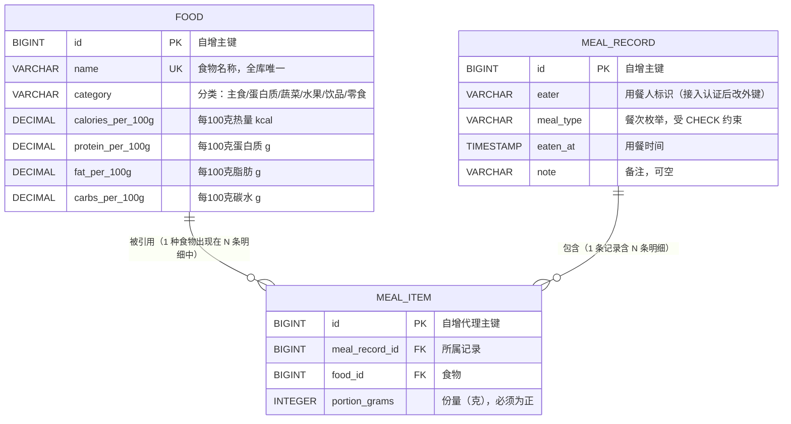

# 数据库设计说明

> 项目：个人健康饮食记录管理系统 · 学号 2412190233 · 姓名 郑俊豪
> 本文对应第 04 周"数据库持久化"要求，说明表结构、关系、主要字段与必要约束。
> 建表脚本：`monolith/src/main/resources/schema.sql`（可重复执行）
> 示例数据：`monolith/src/main/resources/data.sql`（幂等，重跑不会重复插入）

---

## 一、设计目标与总体思路

本周要为"记录一餐并查看当日热量收支"这条业务流程提供持久化支持。设计围绕三个问题展开：

| 问题 | 结论 | 理由 |
| :--- | :--- | :--- |
| 营养数据存几份？ | **每 100 克存一份** | 食物库只维护基准值，任何份量都能折算，不必为每种份量预存一行；也避免"同一食物多个口径"导致统计不一致 |
| "份量"属于谁？ | **属于"记录 × 食物"的组合** | 今天 150g 米饭、昨天 200g 米饭，说明份量不是食物本身的属性，必须放在关联上 |
| 营养合计要不要落库？ | **不落库，读取时即时算** | 省掉冗余列，也就没有"明细改了合计没更新"的不一致风险；单人饮食数据量下，乘法累加代价可忽略 |

因此最终是 **3 张表**：`food`（主数据）、`meal_record`（业务主表）、`meal_item`（带属性的关联表）。

---

## 二、表间关系



关系读法：**一条饮食记录包含多条明细，每条明细指向一种食物并记录该次的份量。**
`meal_record` 与 `food` 之间是典型的多对多，`meal_item` 是它的关联表——
但因为关联上带了一个业务字段（份量），所以它同时也是一个实体。

---

## 三、表结构明细

### 3.1 `food` —— 食物库（主数据）

| 字段 | 类型 | 可空 | 约束 / 说明 |
| :--- | :--- | :-- | :--- |
| `id` | BIGINT | 否 | 主键，自增 |
| `name` | VARCHAR(64) | 否 | **唯一约束 `uk_food_name`**；避免同一食物出现多条口径不一的记录 |
| `category` | VARCHAR(32) | 否 | 分类，用于筛选 |
| `calories_per_100g` | DECIMAL(8,2) | 否 | 每 100 克热量（kcal） |
| `protein_per_100g` | DECIMAL(8,2) | 否 | 每 100 克蛋白质（g） |
| `fat_per_100g` | DECIMAL(8,2) | 否 | 每 100 克脂肪（g） |
| `carbs_per_100g` | DECIMAL(8,2) | 否 | 每 100 克碳水化合物（g） |

必要约束：

- 主键 `id`；
- 唯一键 `uk_food_name (name)`；
- 检查约束 `ck_food_nutrients_non_negative`：四项营养值均不得为负。

用 `DECIMAL(8,2)` 而不是 `FLOAT/DOUBLE`：营养值参与求和与占比计算，
定点小数不会引入二进制浮点误差，`232.00` 就真的是 `232.00`。

### 3.2 `meal_record` —— 饮食记录（业务主表）

| 字段 | 类型 | 可空 | 约束 / 说明 |
| :--- | :--- | :-- | :--- |
| `id` | BIGINT | 否 | 主键，自增 |
| `eater` | VARCHAR(64) | 否 | 用餐人。**当前是字符串**，接入认证后改为 `user_id` 外键 |
| `meal_type` | VARCHAR(16) | 否 | 餐次枚举名：`BREAKFAST` / `LUNCH` / `DINNER` / `SNACK` |
| `eaten_at` | TIMESTAMP | 否 | 用餐时间，精确到分钟 |
| `note` | VARCHAR(255) | 是 | 备注 |

必要约束：

- 主键 `id`；
- 检查约束 `ck_meal_record_type`：`meal_type IN ('BREAKFAST','LUNCH','DINNER','SNACK')`。
  在数据库层兜底，防止绕过应用直接写入脏数据（例如手工 SQL 插入 `'夜宵'`）；
- 复合索引 `idx_meal_record_eater_time (eater, eaten_at)`：
  "查某人某天的记录"是日用汇总的主要访问路径，这个索引直接服务于它。

### 3.3 `meal_item` —— 饮食记录明细（带属性的关联表）

| 字段 | 类型 | 可空 | 约束 / 说明 |
| :--- | :--- | :-- | :--- |
| `id` | BIGINT | 否 | 主键，自增代理键 |
| `meal_record_id` | BIGINT | 否 | 外键 → `meal_record(id)`，`ON DELETE CASCADE` |
| `food_id` | BIGINT | 否 | 外键 → `food(id)` |
| `portion_grams` | INTEGER | 否 | 份量（克） |

必要约束：

- 主键 `id`；
- **唯一约束 `uk_meal_item_record_food (meal_record_id, food_id)`**：
  这是核心业务约束——"同一次用餐里同一种食物只能有一行"。
  有了它，重复加入同一食物时应用层把份量累加，而不是产生两行；
- 外键 `fk_meal_item_record` → `meal_record(id)`，`ON DELETE CASCADE`：
  删除记录时明细自动清理，不留孤儿数据；
- 外键 `fk_meal_item_food` → `food(id)`（**不级联删除**）：
  被历史记录引用的食物不允许删除，否则历史记录会丢失营养依据；
- 检查约束 `ck_meal_item_portion_positive`：`portion_grams > 0`。

---

## 四、一个关键设计决定：为什么用代理主键，而不是复合主键

业务约束是"一次用餐里同一种食物只能有一行"，直觉上会想用 `(meal_record_id, food_id)`
作为复合主键，把这个约束直接交给主键来保证。**但实际实现时这条路在 Hibernate 7 上遇到了问题**：

| 尝试 | 结果 |
| :--- | :--- |
| 用 `Map<Food, Integer>` 表达"食物 → 份量"，配 `@ElementCollection` + `@MapKeyJoinColumn` | 启动即失败：`Association 'MealRecord.items' targets the type 'java.lang.Integer' which is not an '@Entity' type`。Hibernate 把 Map 的**值**位置当成实体关联处理，不允许放基本类型再配 `@Column` |
| 改用 `@EmbeddedId` 复合主键 + `@MapsId` 映射两个外键 | 保存时报 `PropertyAccessException: Could not set value of type [java.lang.Long]: 'MealItemId.foodId'`。在"所属记录尚未持久化"的时序下，`@MapsId` 会尝试给主键对象赋值而失败 |

**最终方案**：`meal_item` 用自增代理主键，业务约束改由**唯一约束**保证：

```sql
PRIMARY KEY (id),
CONSTRAINT uk_meal_item_record_food UNIQUE (meal_record_id, food_id)
```

这个取舍的理由：

1. **业务约束依然由数据库保证**，没有把正确性责任推给应用层；
2. 映射简单，不依赖 `@MapsId` 的复杂时序；
3. 代理主键让 JPA 的 `equals/hashCode`、批处理与后续可能的分库分表都更省事。

代价是多了一列不表达业务含义的 `id`。在"约束强度不变、实现复杂度显著降低"的对比下，这个代价是划算的。

---

## 五、索引与查询对应关系

| 索引 | 服务的查询 | 说明 |
| :--- | :--- | :--- |
| `PRIMARY KEY (id)` × 3 | 按主键查单条 | 三张表都由主键访问 |
| `uk_food_name (name)` | `findByName` | 既是唯一约束也是查询索引，一举两得 |
| `idx_meal_record_eater_time (eater, eaten_at)` | 按人 + 日期区间查记录、统计当日餐次数、统计有记录天数 | 日用汇总的核心路径；复合索引顺序按"等值列在前、范围列在后"安排 |
| `uk_meal_item_record_food (meal_record_id, food_id)` | 记录明细的装载 | 唯一约束同时充当"按记录取明细"的索引 |

`MealRecordRepository` 中对应的查询方法：

```java
List<MealRecord> findByEaterAndEatenAtGreaterThanEqualAndEatenAtLessThanOrderByEatenAtDesc(
        String eater, LocalDateTime start, LocalDateTime end);   // 日用汇总
long countByEaterAndMealTypeAndEatenAt(String eater, MealType type, LocalDateTime at);  // R2 重复提交
long countByEaterAndEatenAtGreaterThanEqualAndEatenAtLessThan(String e, LocalDateTime s, LocalDateTime e2); // R5 每日上限
@Query("SELECT COUNT(DISTINCT FUNCTION('DATE', r.eatenAt)) FROM MealRecord r WHERE ...")   // 演示 @Query
long countDistinctDaysSince(String eater, LocalDateTime since);
```

**关于日用汇总的聚合位置**：热量合计在 Service 层用内存聚合完成，没有写复杂 JPQL。
原因是明细实体的关联结构要在 SQL 里跨两跳 JOIN 才能拿到营养值，写起来可读性差、换个数据库还容易出兼容问题；
而"一个人的一天"数据量极小（每天最多 12 餐、每餐最多 10 种食物），内存聚合的代价可以忽略。
真正需要下推到数据库的聚合（例如跨用户的大范围统计）留到分析服务拆分时再做。

---

## 六、测试数据准备方式（可重复执行）

`data.sql` 在每次应用启动时执行，因此**所有语句必须幂等**：

| 手法 | 用途 |
| :--- | :--- |
| `CREATE TABLE IF NOT EXISTS` | 表已存在时不报错，直接跳过 |
| `INSERT IGNORE` | 主键或唯一键冲突时跳过该行，不报错、不产生重复数据 |
| 主键显式指定（食物与记录） | 保证每次启动后 id 稳定，README 里的 curl 示例可以直接照抄 |

示例数据规模：**12 种食物** + **4 条饮食记录** + **11 条明细**，构成"一天三餐 + 加餐"的完整形态：

```
早餐（2026-09-28 08:00）：全麦面包 80g + 水煮蛋 50g + 牛奶 250g   ≈ 409.3 kcal
午餐（2026-09-28 12:30）：米饭 200g + 鸡胸肉 150g + 西兰花 150g   ≈ 482.5 kcal
晚餐（2026-09-28 19:00）：红薯 200g + 三文鱼 120g + 西兰花 100g   ≈ 455.6 kcal
加餐（2026-09-28 16:00）：苹果 150g + 无糖酸奶 100g              ≈ 150.0 kcal
                                                          当日合计 ≈ 1497.4 kcal
```

日期固定在 2026-09-28 是刻意的：示例输出与截图才能保持稳定可复现，
不会因为"今天是几号"而让文档里的数字对不上。

**测试环境**同样加载这两个脚本（见 `src/test/resources/application-test.yml`），
所以"应用实际跑起来看到的数据"与"测试断言的数据"是同一份，不会各说各话。
数据源换成 H2 内存库并开启 `MODE=MySQL`，使 `AUTO_INCREMENT`、`INSERT IGNORE`、
`CHECK` 等写法在测试与生产环境下行为一致。

---

## 七、MySQL 建库与初始化

```sql
CREATE DATABASE health_diet DEFAULT CHARACTER SET utf8mb4 COLLATE utf8mb4_unicode_ci;
```

字符集选 `utf8mb4`：食物名与备注含中文，`utf8mb4` 是 MySQL 下完整的 UTF-8 实现
（`utf8` 在 MySQL 里只有 3 字节，无法表示部分生僻字与 emoji）。

```powershell
cd monolith
mysql -u root -p health_diet < src/main/resources/schema.sql
mysql -u root -p health_diet < src/main/resources/data.sql
```

连接配置在 `application.yml`，口令通过环境变量注入，不把明文提交到公开仓库：

```yaml
spring:
  datasource:
    url: ${MYSQL_URL:jdbc:mysql://localhost:3306/health_diet?...}
    username: ${MYSQL_USERNAME:root}
    password: ${MYSQL_PASSWORD:}
  jpa:
    hibernate:
      ddl-auto: none        # 表结构由 schema.sql 唯一负责
```

`ddl-auto: none` 是刻意选的：如果让 Hibernate 自动建表，就会出现"schema.sql 定义的约束"
与"Hibernate 推断出来的表"两套 DDL，容易悄悄不一致（例如唯一约束与 CHECK 约束丢失）。
让脚本唯一负责，`docs/database.md` 描述的结构才与实际库一致。

---

## 八、约束清单（便于逐条核对）

| # | 约束 | 所在表 | 类型 | 作用 |
| :-- | :--- | :--- | :--- | :--- |
| 1 | `PRIMARY KEY (id)` | food / meal_record / meal_item | 主键 | 唯一标识行 |
| 2 | `uk_food_name UNIQUE (name)` | food | 唯一 | 食物名不重复 |
| 3 | `ck_food_nutrients_non_negative` | food | CHECK | 营养值非负 |
| 4 | `ck_meal_record_type` | meal_record | CHECK | 餐次只能是四个枚举值 |
| 5 | `idx_meal_record_eater_time` | meal_record | 索引 | 加速按人按日查询 |
| 6 | `uk_meal_item_record_food UNIQUE (meal_record_id, food_id)` | meal_item | 唯一 | 一次用餐里同种食物只有一行 |
| 7 | `fk_meal_item_record → meal_record(id) ON DELETE CASCADE` | meal_item | 外键 | 删除记录时清理明细 |
| 8 | `fk_meal_item_food → food(id)` | meal_item | 外键 | 被引用的食物不可删除 |
| 9 | `ck_meal_item_portion_positive` | meal_item | CHECK | 份量为正 |
