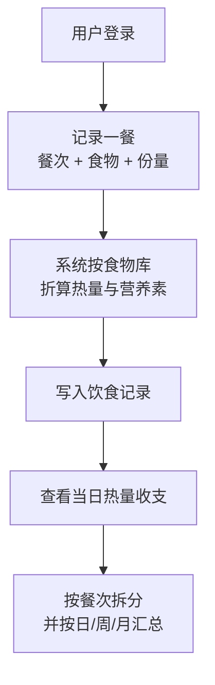
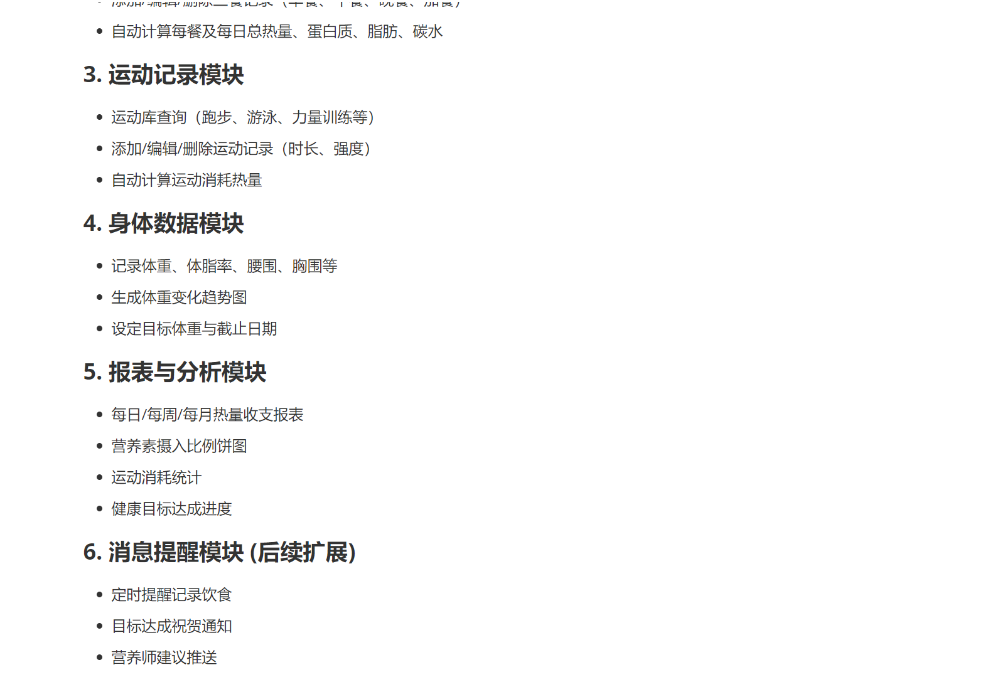
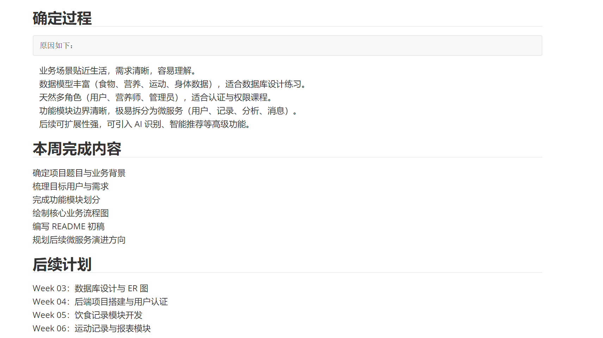
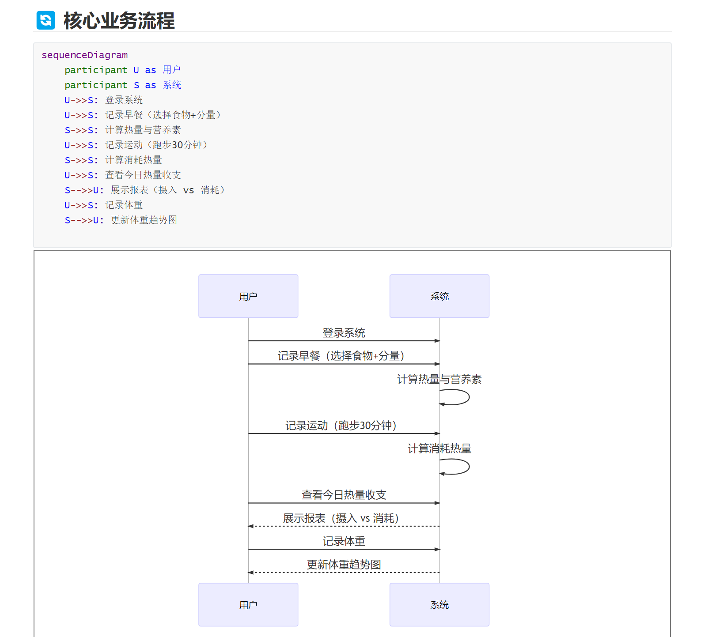
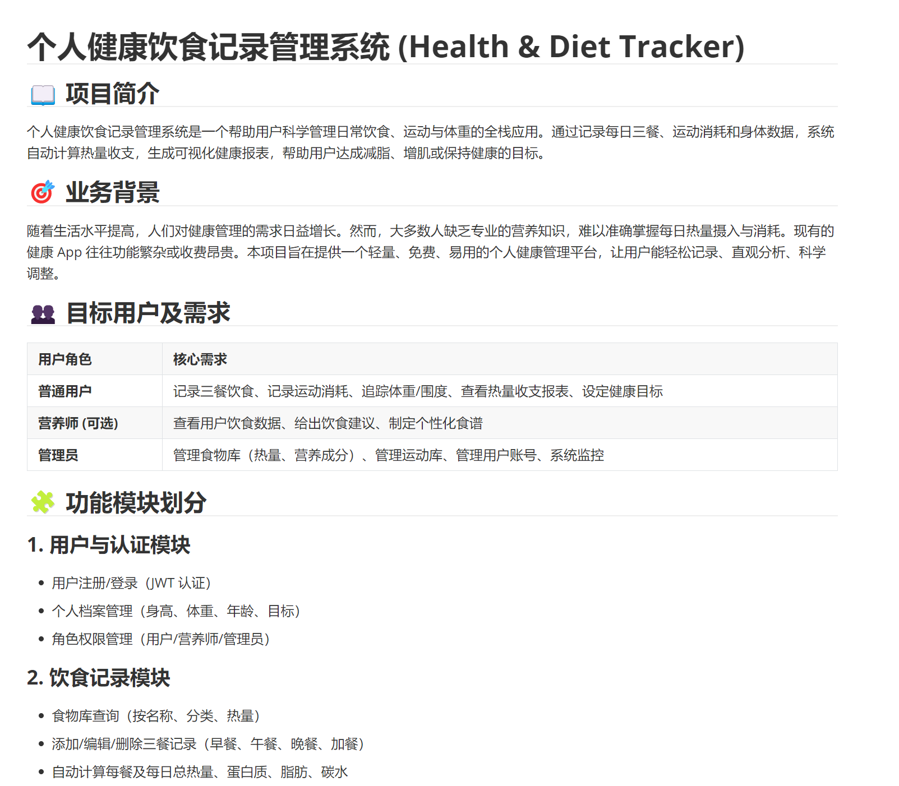
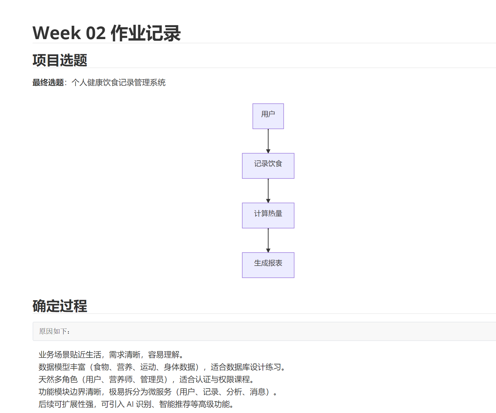

# Week 02 作业记录

> 学号 2412190233 · 姓名 郑俊豪
> 本周任务：确定本学期持续演进的唯一课程项目，并在 README 中完整描述项目背景、目标用户与功能设计。
> 批改反馈：方向明确，但对**项目范围、后续演进与业务规则**的描述偏简略 —— 本文与 README 已按此补充。

---

## 一、项目选题

**最终选题：个人健康饮食记录管理系统（Health & Diet Tracker）**

### 1.1 确定过程

在课程给出的候选方向（宠物医院、购物、图书借阅、健身房会员、餐厅点餐、二手交易）之外，
最终选择自拟的健康饮食记录方向，理由如下：

| 考虑维度 | 本选题的情况 |
| :--- | :--- |
| 业务场景是否具体 | 场景是"记一餐 → 看当天热量"，具体到可以写出一条完整的接口链路，不是笼统的"健康管理平台" |
| 是否有真实问题 | 普通人难以估算一餐热量，现有 App 要么繁杂要么收费，这是真实存在的痛点 |
| 数据模型是否够用 | 既有主数据（食物库）又有业务数据（饮食记录），且两者关系带业务属性（份量），能支撑数据库设计练习 |
| 角色是否多样 | 普通用户 / 营养师 / 管理员三种角色，天然对应认证与权限课程 |
| 能否拆分微服务 | 用户、记录、分析三个边界清晰，拆分时不需要硬造需求 |
| 是否便于验证 | 热量与营养素可手工核算，业务规则对错一眼可判，测试好写 |

**排除了什么**：宠物医院与图书借阅这两个方向的数据关系更像"纯业务表堆叠"，
缺少"数值计算 + 业务规则"这一层，练习价值不如本选题；
二手交易涉及聊天与支付，范围过大，两周内难以做出闭环。

### 1.2 选题的初步边界

**做**：饮食记录（含食物与份量）、食物库查询、当日热量与营养素汇总、多角色概念。

**明确不做**：社交动态、商城与付费、菜品图片识别、硬件（手环）对接、多端 App（先做 REST 接口）。

### 1.3 为什么适合在后续课程中持续演进

每个后续主题在本项目中都有真实落点，不需要为了用技术而造需求：

| 课程主题 | 落点 |
| :--- | :--- |
| 数据库持久化 | 食物、饮食记录、记录明细三张表及约束 |
| 认证授权 | 用户表 + JWT，用餐人从字符串改为外键 |
| 事务 | 记录一餐要写两张表 |
| 消息 | 目标达成提醒、定时提醒、营养师建议推送 |
| 服务拆分 | 用户服务 / 记录服务 / 分析服务 |
| 监控部署 | Actuator 指标、容器化、CI/CD |

---

## 二、功能规划

### 2.1 用户角色与需求

| 用户角色 | 核心需求 | 计划实现周次 |
| :--- | :--- | :--- |
| **普通用户** | 记录三餐与加餐、查看每餐营养、查看当日汇总、设定健康目标 | 记录与汇总 Week 04；目标设定待定 |
| **营养师**（可选） | 查看用户饮食数据、给出建议、制定食谱 | 后续 |
| **管理员** | 维护食物库与运动库、管理账号、系统监控 | 后续 |

### 2.2 功能模块划分

| # | 模块 | 具体功能 | 优先级 |
| :-- | :--- | :--- | :--- |
| 1 | 用户与认证 | 注册登录（JWT）、个人档案、角色权限 | 高（Week 05） |
| 2 | 食物库 | 名称检索、分类筛选、营养基准值（每 100 克） | 高（Week 04 已做查询） |
| 3 | 饮食记录 | 记录一餐、查询记录、查询明细、按人按日查询 | 高（Week 04） |
| 4 | 报表与分析 | 当日汇总、分餐次拆分、营养素比例、周月趋势 | 中（当日汇总 Week 04） |
| 5 | 身体数据 | 体重/体脂/腰围记录、趋势、目标体重 | 中 |
| 6 | 消息提醒 | 定时提醒、目标达成通知、建议推送 | 低（对应消息课程） |

### 2.3 核心业务流程（规划）

主流程"记录一餐并查看当日热量收支"已在 Week 04 实现，详细时序图见
[README 第五节](../README.md#五核心业务流程) 与
[Week 04 记录](week-04/index.md)。

### 2.4 计划中的业务规则（Week 04 已落地）

规划阶段就意识到：**没有业务规则，项目会退化成一个纯粹的增删改查练习**。
因此提前确定了要在 Service 层实现、且可被测试验证的规则方向：

| 方向 | 具体规则 | 落地情况 |
| :--- | :--- | :--- |
| 数值范围 | 单次用餐热量不得超过上限（1500 kcal） | Week 04 已实现（R3） |
| 时间一致性 | 用餐时间必须与所选餐次相符 | Week 04 已实现（R2） |
| 引用完整性 | 食物必须存在于食物库 | Week 04 已实现（R1） |
| 录入合理性 | 份量上限、单餐食物种类上限、每日餐次上限 | Week 04 已实现（R1/R4/R5） |
| 目标达成 | 当日摄入超过目标时给出提示 | 待 Week 05 引入用户目标后实现 |

---

## 三、本周完成内容

- 确定项目题目与业务背景，说明要解决的实际问题；
- 梳理三类目标用户与各自需求；
- 完成 6 个功能模块的划分，并为每个模块标注具体功能与优先级；
- 绘制核心业务流程图（记录一餐 → 折算营养 → 汇总收支）；
- 明确项目边界（做什么、不做什么）；
- 规划 7 个后续演进方向，并与课程主题一一对应；
- 编写 README 初稿。

## 四、后续计划

| 周次 | 计划 |
| :--- | :--- |
| Week 03 | 创建 Spring Boot 工程：启动类、`/api/hello`、Actuator 健康检查、启动测试 |
| Week 04 | 业务建模、REST 接口、MySQL 持久化与业务规则 |
| Week 05 | 用户认证（JWT）与多用户数据隔离 |

## 五、本周产出与截图

- README 中的项目简介、业务流程与功能模块划分：见仓库根目录 [README.md](../../../README.md)
- README 在 GitHub 上的渲染截图：见 `screenshots/` 目录

