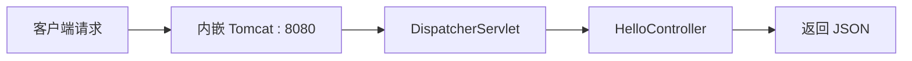

# Week 03 作业记录

- **项目**：个人健康饮食记录管理系统（Health & Diet Tracker）
- **学号 / 姓名**：2412190233 / 郑俊豪
- **工程位置**：仓库根目录 `monolith/`，与 `docs/` 同级

## 本周目标

1. 创建可运行的 Spring Boot 工程，落在 `monolith/` 下与 `docs/` 同级。
2. 完成基础配置（应用名、端口、配置文件格式）。
3. 提供一个用于验证运行状态的 GET 接口。
4. 编写启动测试，并用 Maven 实际跑通，证明"工程真的能起来"。

## 工程创建与配置

采用 Maven 管理依赖，仓库内自带 Maven Wrapper，因此不要求本机装有 Maven，在 `monolith/` 目录下可直接执行 `./mvnw`。

| 项目 | 取值 |
| --- | --- |
| JDK | 25（本机 25.0.4.1） |
| Spring Boot | 4.0.8 |
| Maven | 3.9.16（通过 `mvnw` 使用） |
| 包名 | `com.zjgsu.hdt` |
| 配置文件 | `application.yml` |
| 默认端口 | 8080（未修改） |

包名说明：课程要求为 `com.zjgsu.<姓名缩写>`，姓名首字母缩写为 `zjh`；本仓库实际使用 `com.zjgsu.hdt`，`hdt` 取项目名 Health Diet Tracker 的首字母，便于后续微服务拆分时统一命名前缀。

关键产物：启动类 `HealthDietTrackerApplication`、状态验证接口 `HelloController`（`GET /api/hello`）、配置文件 `src/main/resources/application.yml`、启动测试 `HealthDietTrackerApplicationTests`。

配置要点：`spring.application.name` 设为 `health-diet-tracker`，`server.port` 保持 8080，Actuator 仅暴露 `health` 与 `info` 端点并打开健康检查明细，便于排查。

## 运行验证（接口与健康检查）

### 1. 启动应用

```bash
cd monolith
./mvnw spring-boot:run
```

控制台出现 `Tomcat started on port 8080` 与 `Started HealthDietTrackerApplication` 即代表启动成功。

请求路径如下：



### 2. 验证状态接口

```bash
curl http://localhost:8080/api/hello
```

真实响应：

```json
{
  "application": "health-diet-tracker",
  "message": "个人健康饮食记录管理系统已启动",
  "timestamp": "2026-10-12 13:14:28"
}
```

其中 `application` 取自配置项 `spring.application.name`，`timestamp` 为服务器当前时间，字段顺序固定（使用 `LinkedHashMap`），方便截图与重复比对。

### 3. 验证健康检查

```bash
curl http://localhost:8080/actuator/health
```

关键返回内容为：

```json
{ "status": "UP" }
```

`components` 中包含 `db`（数据库连通性）、`diskSpace`、`ping`、`livenessState`、`readinessState`，状态均为 `UP`。

## 启动测试

按作业要求编写 `@SpringBootTest` 启动测试，方法名为 `contextLoads`：

```bash
./mvnw test
```

本周先建立启动测试与运行状态接口测试等少量测试，用于确认 Spring 容器、Web MVC 与配置全部就绪；后续周次在此基础上继续扩展。

作为参考，第 4 周结束时同一套测试的最终结果已经增长到：

```
Tests run: 75, Failures: 0, Errors: 0, Skipped: 0
BUILD SUCCESS
```

## 本周遇到的问题与解决办法

本周最有价值的产出其实是下面这几条：Spring Boot 4 相对 3.x 有多处重命名与迁移，全部是在实际运行中暴露并逐个修掉的。

1. **`spring-boot-starter-web` 依赖解析失败**
   - 现象：按 3.x 习惯声明 `spring-boot-starter-web`，Maven 无法解析该 starter。
   - 原因：Spring Boot 4.0.8 已将其改名为 `spring-boot-starter-webmvc`，旧名只保留到 4.0.0 为止。
   - 解决：`pom.xml` 中的依赖改为 `spring-boot-starter-webmvc`。

2. **`@DataJpaTest` 找不到**
   - 现象：编写 JPA 映射测试时，`@DataJpaTest` 无法导入、编译不通过。
   - 原因：Spring Boot 4 已移除该注解，`spring-boot-test-autoconfigure` 4.0.8 中不再提供。
   - 解决：验证 JPA 映射改用 `@SpringBootTest` 启动完整上下文来断言，虽然启动更慢，但结果更贴近真实运行。

3. **`@WebMvcTest` 包路径变更**
   - 现象：沿用 3.x 的导入路径，Web 层切片测试编译失败。
   - 原因：该注解迁到了新包 `org.springframework.boot.webmvc.test.autoconfigure.WebMvcTest`，且需要额外的测试 starter 支撑。
   - 解决：更新导入路径，并引入 `spring-boot-starter-webmvc-test` 依赖。

4. **`spring.jackson` 配置导致启动时属性绑定失败**
   - 现象：在 `application.yml` 中写入 `serialization.write-dates-as-timestamps`、`default-property-inclusion` 等属性后，应用启动即报配置绑定错误。
   - 原因：Spring Boot 4 使用 Jackson 3，Jackson 2 时代的属性名已不适用。
   - 解决：直接不配置该节点。Boot 中日期序列化默认即为 ISO-8601，null 字段默认也不省略，已满足本项目需要。

5. **Mockito 无法初始化 MockMaker**
   - 现象：涉及 Mockito 的测试报 `IllegalStateException: Could not initialize plugin: interface org.mockito.plugins.MockMaker`。
   - 原因：JDK 21+ 不再允许运行时动态挂载 Java agent，Mockito 必须显式以 `-javaagent` 方式传入。
   - 解决：用 `maven-dependency-plugin` 把 `mockito-core.jar` 复制到 `target/`，再在 surefire 的 `argLine` 中引用该 jar，测试随即恢复正常。

## 本周完成内容

- 创建 `monolith/` Spring Boot 工程并配置 Maven Wrapper，使工程在未安装 Maven 的环境下也可直接构建。
- 确定包名 `com.zjgsu.hdt` 与配置文件 `application.yml`，编写启动类 `HealthDietTrackerApplication`。
- 实现状态验证接口 `GET /api/hello`，并配置、验证 Actuator 健康检查 `GET /actuator/health`。
- 编写 `@SpringBootTest` 启动测试，通过 `./mvnw test` 跑通。
- 处理 Spring Boot 4 的 5 处重命名与迁移问题，工程可稳定构建与启动。

## 截图


这张截图应展示 IDE 中 `monolith/` 的工程结构，能看到 `pom.xml`、启动类 `HealthDietTrackerApplication` 与 `application.yml`。


这张截图应展示在 `monolith/` 目录执行 `./mvnw test` 的结尾输出，能看到 `BUILD SUCCESS`。


这张截图应展示 `./mvnw spring-boot:run` 的启动日志，能看到 `Tomcat started on port 8080` 与 `Started HealthDietTrackerApplication`。


这张截图应展示浏览器或 curl 访问 `http://localhost:8080/api/hello` 的返回 JSON，含 `application`、`message`、`timestamp` 三个字段。


这张截图应展示访问 `http://localhost:8080/actuator/health` 返回的 `{"status":"UP"}` 与各 component 状态。

## 后续计划

Week 04：实现业务建模、REST 接口与 MySQL 持久化。

- 依据数据库设计，建立食物、饮食记录等实体与 Repository。
- 将状态验证接口扩展为业务接口，提供饮食记录的增删改查。
- 接入 MySQL，打通持久化链路，并补充集成测试，把测试规模从启动测试扩展到完整用例集。
