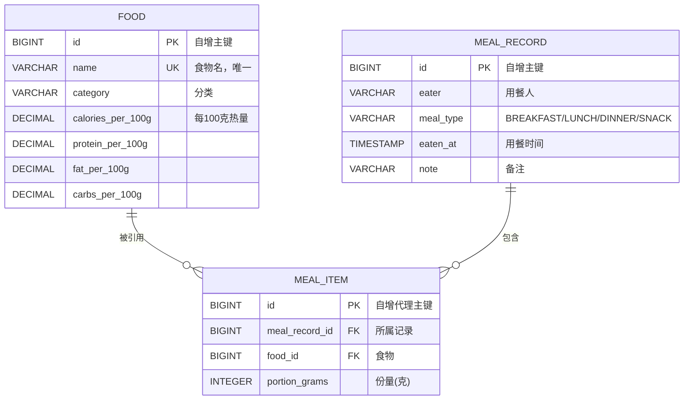
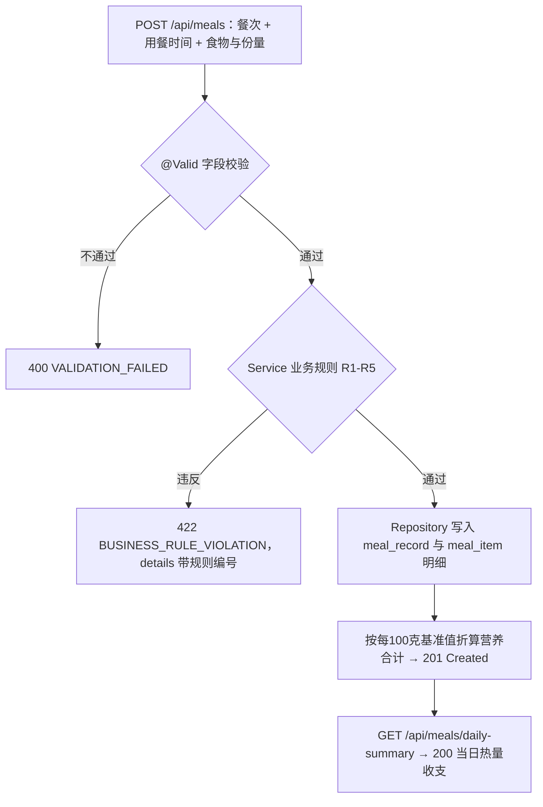

# Week 04 作业记录

> 个人健康饮食记录管理系统（Health & Diet Tracker）· 学号 2412190233 · 姓名 郑俊豪
> 技术栈：JDK 25、Spring Boot 4.0.8、Maven Wrapper、MySQL 8.x（默认配置）、H2 2.4.240（测试与 demo 演示用）；包名 `com.zjgsu.hdt`，端口 8080。

## 本周目标

Week 02 定了题目，Week 03 只搭出一个能启动的空工程。本周要让工程跑通**一条真正有业务含义的完整链路**：

| 序号 | 任务 | 交付物 |
| :-- | :--- | :--- |
| 1 | 业务建模 | 一条核心业务流程、3 个业务实体与关系、5 条业务规则 |
| 2 | 单体应用实现 | 2 个以上业务模型 + Service + Controller + 9 个 REST 接口（业务接口 6 个） |
| 3 | 数据库持久化 | MySQL 3 张表 + Spring Data JPA + DTO 入参 + 可重复执行的测试数据 |
| 4 | 测试与验证 | Repository / Service / API 三层分别验证，`./mvnw test` 全绿 |

## 一、业务建模

### 实现思路

本周要实现的核心业务流程只有一条：**记录一餐并查看当日热量收支**。选它是因为它同时包含写（新增记录）和读（当日聚合），中间还夹着可校验的业务规则，能一次把 Controller → Service → Repository → 数据库这条链路走完。

用户 `POST /api/meals` 提交"餐次 + 用餐时间 + [{食物ID, 份量克}]"，Service 校验业务规则后写入数据库，并返回**服务端算好的营养合计**；用户再 `GET /api/meals/daily-summary` 查看当日总热量与分餐次拆分。营养值一律按**每 100 克**存储，实际摄入 = 基准值 × 份量 ÷ 100。

本周涉及 3 个业务实体：`Food`（食物库主数据）、`MealRecord`（饮食记录）、`MealItem`（记录明细，对应中间表 `meal_item`）；关系为 `MEAL_RECORD 1—N MEAL_ITEM N—1 FOOD`，字段定义见下图。



**两个建模取舍**：一是份量放在中间表上而不是食物或记录上——同一种食物在不同记录里份量不同（今天 150g 米饭、昨天 200g），说明份量属于"记录 × 食物"这个组合；中间表带 `UNIQUE(meal_record_id, food_id)`，由数据库保证"一次用餐里同一种食物只有一行"。二是营养合计不落库，由明细在读取时即时算出，省掉冗余列，也不存在"明细改了合计没更新"的不一致风险。

本周在 Service 中检查的业务规则共 5 条（作业只要求 1 条），集中在 `MealRecordService`，阈值统一由 `BusinessLimits` 提供：

| 编号 | 规则 | 阈值 | 为什么需要它 |
| :--- | :--- | :--- | :--- |
| **R1** | 食物必须存在于食物库，份量为正且不超过上限 | ≤ 5000 g | 拦截"把 150 打成 150000"这类录入错误；缺失的食物 ID 会一次性全部报出 |
| **R2** | 用餐时间必须落在所选餐次的时间窗内，且同一时间不允许重复提交同餐次 | 早 05:00–10:59、午 11:00–14:59、晚 17:00–21:59、加餐其余时刻 | 保证"早餐"确实是早餐，分餐次统计才有意义；同时防止连点重复提交 |
| **R3** | 单次用餐热量不得超过上限 | 1500 kcal | 单餐超过 1500 kcal 基本意味着份量填错 |
| **R4** | 单次用餐最多包含若干种食物 | 10 种 | 超过 10 种的一次用餐绝大多数是数据录错，建议拆成多条记录 |
| **R5** | 同一天最多记录若干餐 | 12 餐 | 防止脚本或误操作在一天内灌入大量记录 |



### 运行命令

```powershell
cd microservices-practice-2412190233
Get-Content docs\project-proposal.md                                          # 看本周更新的三节
Select-String -Path docs\project-proposal.md -Pattern 'erDiagram|flowchart'   # 确认 Mermaid 语法
```

### 结果

`docs/project-proposal.md` 中补入了本周的核心业务流程、3 个业务实体及其关系、5 条业务规则与阈值出处；文档里的阈值与 `BusinessLimits` 保持一致，避免文档与实现说法不一。


这张截图应展示 `docs/project-proposal.md` 中本周新增的业务流程、实体关系与业务规则三节。

## 二、单体应用实现

### 实现思路

应用仍是单体，但按职责分包：`controller` / `service` / `repository` / `model` / `dto` / `exception`。

- **Controller 只做 HTTP 输入输出**：`MealController` 收到请求直接交给 `MealRecordService`，自己不碰 Repository、不写 SQL。
- **业务规则全部落在 Service**：`MealRecordService` 按 R1→R5 顺序校验，任一条不满足就抛 `BusinessRuleException`，由全局异常处理器统一转成 422。
- **DTO 承载输入输出**：`MealRecordRequest` / `MealItemRequest` 带 `@Valid`，响应是 `MealRecordResponse` / `DailySummaryResponse`，实体不直接暴露。
- **营养换算只做一次**：集中在 `NutritionCalculator`，客户端直接用返回的合计值，避免各端各算一遍导致数字不一致。

本周共 9 个 REST 接口，业务接口 6 个（前 2 个是 Week 03 已有的）：

| # | 方法 | 路径 | 说明 | 成功状态码 |
| :-- | :--- | :--- | :--- | :--- |
| 1 | GET | `/api/hello` | 运行状态验证 | 200 |
| 2 | GET | `/actuator/health` | 健康检查 | 200 |
| 3 | GET | `/api/foods` | 食物库列表，支持 `keyword` / `category` 筛选 | 200 |
| 4 | GET | `/api/foods/categories` | 食物分类列表 | 200 |
| 5 | GET | `/api/meals` | 查询某人的饮食记录（`eater` 参数） | 200 |
| 6 | GET | `/api/meals/{id}` | 查询单条记录及明细 | 200 |
| 7 | POST | `/api/meals` | **新增一条饮食记录** | 201 |
| 8 | GET | `/api/meals/daily-summary` | 某人某日热量汇总 | 200 |
| 9 | GET | `/api/meals/rules` | 当前生效的业务规则与餐次时间窗 | 200 |

错误响应统一成一套 `{status, error, code, message, path, details}` 结构，客户端只写一套解析逻辑：

| 状态码 | `code` | 触发场景 |
| :--- | :--- | :--- |
| 400 | `VALIDATION_FAILED` / `MALFORMED_REQUEST_BODY` / `INVALID_PARAMETER_TYPE` | 依次为：字段校验失败、JSON 非法或枚举不存在、路径或查询参数类型错误 |
| 404 | `RESOURCE_NOT_FOUND` | 资源不存在 |
| 422 | `BUSINESS_RULE_VIOLATION` | 格式合法但违反业务规则，`details` 里带规则编号 |
| 500 | `INTERNAL_ERROR` | 未预期错误（堆栈只写日志，不返回给客户端） |

### 运行命令

```powershell
cd monolith
$env:SPRING_PROFILES_ACTIVE = "demo"        # 本机暂无 MySQL 时用 demo(H2) 先跑起来看效果
./mvnw spring-boot:run                      # Windows 下也可写 .\mvnw spring-boot:run

curl.exe http://localhost:8080/api/hello
curl.exe http://localhost:8080/actuator/health

# README 中补充的 curl 示例一：查询示例数据的当日热量汇总
curl.exe "http://localhost:8080/api/meals/daily-summary?eater=demo-user&date=2026-09-28"

# curl 示例二：新增一餐（米饭 200g + 鸡胸肉 150g）
curl.exe -X POST http://localhost:8080/api/meals -H "Content-Type: application/json" `
  -d '{\"eater\":\"demo-user\",\"mealType\":\"LUNCH\",\"eatenAt\":\"2026-09-30T12:30:00\",\"note\":\"工作餐\",\"items\":[{\"foodId\":1,\"portionGrams\":200},{\"foodId\":3,\"portionGrams\":150}]}'
```

### 结果

`POST /api/meals` 返回 **201 Created**，合计由服务端算出：米饭 232.00 + 鸡胸肉 199.50 = `totalCalories: 431.5`，`totalProtein: 42.1`，`totalGrams: 350`。`GET /api/meals/daily-summary?eater=demo-user&date=2026-09-28` 返回 **200**：

```json
{ "date":"2026-09-28", "eater":"demo-user", "mealCount":4, "totalCalories":1497.4,
  "totalProtein":101.78, "totalFat":41.45, "totalCarbs":180.9, "totalGrams":1550,
  "byMealType":[
    {"mealType":"BREAKFAST","mealTypeLabel":"早餐","count":1,"calories":409.3}, {"mealType":"LUNCH","mealTypeLabel":"午餐","count":1,"calories":482.5},
    {"mealType":"DINNER","mealTypeLabel":"晚餐","count":1,"calories":455.6}, {"mealType":"SNACK","mealTypeLabel":"加餐","count":1,"calories":150.0}],
  "singleMealLimit":1500 }
```

业务规则真的会拦截：把 2000g 米饭（2320 kcal）记成一餐，命中 R3 返回 **422**：

```json
{ "status":422, "error":"Unprocessable Entity", "code":"BUSINESS_RULE_VIOLATION",
  "message":"本次用餐热量 2320.00 kcal 超过单餐上限 1500 kcal，请调整份量或拆分为多条记录",
  "path":"/api/meals",
  "details":["违反规则：R3 —— 单次用餐热量不得超过 1500 kcal"] }
```

其余规则的消息同样具体：R2 为 `"用餐时间 20:00 不在「早餐」的合理时间窗 05:00-10:59 内，请改用与时间相符的餐次"`；R1 为 `"食物库中不存在以下 ID：[99999]，请先通过 GET /api/foods 确认可用食物"`。字段校验失败 400 的 `details` 为 `["eater: 用餐人不能为空", "items: 至少需要包含一种食物"]`；`/api/meals/abc` 返回 400，`"code": "INVALID_PARAMETER_TYPE"`，`details` 为 `["参数 id 的取值 abc 无法解析为 Long"]`。15 条请求的完整响应存档在 `验证脚本/验证输出-接口响应.txt`，可在应用运行时用 `python 验证脚本/collect_api_transcript.py` 重新生成。


这张截图应展示 `./mvnw spring-boot:run` 的启动日志，能看到端口 8080 与 Tomcat started 一行。


这张截图应展示 curl 新增一餐的请求与 201 响应，响应体里有 `totalCalories: 431.5`。


这张截图应展示 422 响应，`details` 里能看到违反的规则编号 R2 或 R3。

## 三、数据库持久化

### 实现思路

- **接入 MySQL 8.x**：默认连本机 `health_diet` 库，库名、账号、口令在 `application.yml` 里，口令用环境变量注入，不把明文口令提交到公开仓库。
- **表结构由脚本唯一负责**：建表脚本 `monolith/src/main/resources/schema.sql`，示例数据 `monolith/src/main/resources/data.sql`；JPA 侧 `ddl-auto: none`，不让 Hibernate 自动建表，避免两套 DDL 打架。
- **脚本可重复执行**：建表用 `CREATE TABLE IF NOT EXISTS`，插数据用 `INSERT IGNORE`，重跑不报错也不重复插入。
- **数据访问放在 `repository` 包**：`MealRecordRepository`、`FoodRepository` 都是 Spring Data JPA 接口，查询用方法名派生，没有手写 SQL 散落在 Service 里。
- **DTO 承载 API 输入**：请求体只包含客户端该传的字段（食物 ID + 份量），不允许传数据库主键与营养值。

`docs/database.md` 中记录的三张业务表：

| 表 | 主键 | 主要字段 | 约束 |
| :--- | :--- | :--- | :--- |
| `food` | `id` 自增 | `name`、`category`、四个 `*_per_100g` 营养列 | `name` 唯一；营养列非空 |
| `meal_record` | `id` 自增 | `eater`、`meal_type`、`eaten_at`、`note` | `(eater, meal_type, eaten_at)` 配合 R2 做重复提交保护 |
| `meal_item` | `id` 自增 | `meal_record_id`、`food_id`、`portion_grams` | 两个外键分别指向 `meal_record` 与 `food`；`UNIQUE(meal_record_id, food_id)` |

外键策略上，删记录会级联删掉自己的明细，但**食物被明细引用时不允许删除**，否则历史记录的营养依据就断了。

### 运行命令

```powershell
mysql -u root -p -e "CREATE DATABASE health_diet DEFAULT CHARACTER SET utf8mb4 COLLATE utf8mb4_unicode_ci;"
cd monolith                                  # 建表 + 灌入示例数据，两个脚本都幂等，重跑结果一致
mysql -u root -p health_diet < src/main/resources/schema.sql
mysql -u root -p health_diet < src/main/resources/data.sql
$env:MYSQL_USERNAME = "root"                 # 口令走环境变量，不写进仓库
$env:MYSQL_PASSWORD = "你的口令"
./mvnw spring-boot:run
curl.exe http://localhost:8080/actuator/health      # 期望 {"status":"UP", ...}
```

本地 MySQL 的安装、建库与连接配置步骤已写进 README。

### 结果

`SHOW TABLES;` 得到 3 张业务表：`food`、`meal_record`、`meal_item`。重复执行 `schema.sql` 与 `data.sql` 不报错，示例数据行数保持不变，可随时把环境恢复到演示状态。应用连上 MySQL 后 `/actuator/health` 返回 `UP`，`GET /api/foods` 能读到 `data.sql` 预置的食物。


这张截图应展示 mysql 客户端里 `SHOW TABLES;` 与 `DESC meal_item;` 的结果，能看到两个外键与唯一约束。


这张截图应展示连续两次执行 `schema.sql` 与 `data.sql`，并用 `SELECT COUNT(*)` 证明行数未增加。

## 四、测试与验证

### 实现思路

从下往上分四层验证，测试全部使用 **H2 2.4.240 内存库（MySQL 兼容模式）**，所以跑测试的机器不需要装 MySQL：

1. **Repository 读写**：`MealRecordRepositoryTest` 直接对 Repository 增删查，验证份量往返一致、级联删除、同一食物份量累加等行为。
2. **Service 业务规则**：`MealRecordServiceTest` 用 Mockito 隔离 Repository，逐条验证 R1–R5，把"规则是否真的拦住"和"数据库是否可用"分开。
3. **API 正常与错误响应**：`MealControllerTest`（MockMvc 切片）与 `MealApiIntegrationTest`（TestRestTemplate 真实 HTTP，走完整链路到 H2）覆盖 200 / 201 / 400 / 404 / 422；边界值另有 `MealTypeTest` 参数化验证餐次时间窗（如 10:59 属于早餐、11:00 属于午餐），`NutritionCalculatorTest` 验证营养换算与四舍五入。

测试数据在测试启动时自动准备（H2 建表 + 灌数），不依赖任何手工前置步骤，因此可以反复执行。

### 运行命令

```powershell
cd monolith
./mvnw test                                  # 一键执行全部测试，自动准备数据，不需要 MySQL
.\mvnw test                                  # Windows PowerShell 下等价写法
./mvnw test -Dtest=MealRecordServiceTest     # 只看某一层结果
```

### 结果

`./mvnw test` 输出：**Tests run: 75, Failures: 0, Errors: 0, Skipped: 0 — BUILD SUCCESS**，重复执行结果一致。

| 测试类 | 数量 | 验证内容 |
| :--- | :-- | :--- |
| `HealthDietTrackerApplicationTests` | 1 | Spring 上下文可加载 |
| `MealRecordRepositoryTest` | 9 | Repository 读写、份量往返一致性、级联删除、重复食物份量累加 |
| `MealRecordServiceTest` | 11 | R1–R5 业务规则（Mockito 隔离 Repository） |
| `MealControllerTest` | 11 | MockMvc 切片，覆盖 200/201/400/404/422 |
| `MealApiIntegrationTest` | 12 | TestRestTemplate 真实 HTTP，完整链路到 H2 |
| `MealTypeTest` | 23 | 餐次时间窗边界值（参数化测试） |
| `NutritionCalculatorTest` | 7 | 营养换算与四舍五入 |
| **合计** | **75** | 上表 74 个，另含 Week 03 遗留的 `HelloControllerTest` 1 个 |


这张截图应展示 `./mvnw test` 的结尾输出，包含 `Tests run: 75, Failures: 0, Errors: 0` 与 `BUILD SUCCESS`；同一张截图里再执行一次仍是同样结果，证明测试数据准备可重复。


这张截图应展示 `/api/meals/abc` 返回 400 且 `code` 为 `INVALID_PARAMETER_TYPE`。

## 五、本周遇到的问题与解决办法

**问题 1：中间表用 `Map<Food, Integer>` 映射，启动就报错。** 最初把明细设计成 `Map<Food, Integer>`（食物 → 份量），想用 `@ElementCollection` + `@MapKeyJoinColumn` 直接映射，结果应用启动时报：

```
Association 'com.zjgsu.hdt.model.MealRecord.items' targets the type 'java.lang.Integer'
which is not an '@Entity' type
```

原因是在 Spring Boot 4 / Hibernate 7 下，Hibernate 会把 Map 的**值位置**当成实体关联来处理，不允许在值位置放基本类型再配 `@Column`。这条路走不通。

**问题 2：改用复合主键 `@EmbeddedId` + `@MapsId` 也失败。** 换成"`meal_record_id` + `food_id` 做复合主键"的写法后报：

```
PropertyAccessException: Could not set value of type [java.lang.Long]: 'MealItemId.foodId'
```

排查后确认是时序问题：在"记录尚未持久化"的阶段，`@MapsId` 会尝试把外键值赋给主键对象，而此时主键对象还没准备好，赋值就失败了。

**最终方案**：把中间表建成**独立实体 `MealItem`**，用自增代理主键，唯一性改由 `UNIQUE(meal_record_id, food_id)` 保证——"一次用餐里同一种食物只有一行"本来就应该由数据库兜底，而不是靠复合主键强行表达。映射简单，写入时也不再有"先有记录还是先有明细"的时序问题。复合主键在概念上更"漂亮"，却引入了持久化顺序的隐式依赖；换成代理主键 + 唯一约束后代码直白很多，代价只是多了一个自增列。

**问题 3：营养合计放不放进数据库。** 一度想在 `meal_record` 上加 `total_calories` 等冗余列，写记录时算一次存下来。但修改明细时很容易忘记同步更新合计，而这正是数据不一致最经典的来源。最终改为不落库、读取时即时计算，由 `NutritionCalculator` 现算，代价可忽略，换来的是"永远不会不一致"。

**问题 4：错误响应的粒度怎么划。** 400 与 422 的边界是这时想清楚的：**字段格式不合法**属于请求本身有问题，返回 400（`VALIDATION_FAILED`）；**格式没问题但业务上不允许**返回 422（`BUSINESS_RULE_VIOLATION`），并在 `details` 里带上规则编号，前端可以直接拿来提示用户。

**运行命令与结果**：上述两个映射异常都在**应用启动阶段**抛出，执行 `cd monolith` 后 `./mvnw spring-boot:run`（或 `./mvnw test`）即可在日志里复现；改用"独立实体 `MealItem` + 自增代理主键 + `UNIQUE(meal_record_id, food_id)`"的方案后，同一条启动命令不再报错，`./mvnw test` 的 75 个测试全部通过。

## 六、完成内容小结

| 作业要求 | 完成情况 |
| :--- | :--- |
| 更新 `docs/project-proposal.md`：一条核心业务流程 | "记录一餐并查看当日热量收支"；3 个业务实体与关系为 `MEAL_RECORD 1—N MEAL_ITEM N—1 FOOD` |
| 1 条在 Service 中检查的业务规则 | 5 条（R1–R5），集中在 `MealRecordService`，阈值统一在 `BusinessLimits` |
| 至少 2 个业务模型；1 个 Service + 1 个 Controller | `Food`、`MealRecord`（另有 `MealItem`）；`MealRecordService`、`FoodService`、`DailySummaryService`；`MealController`、`FoodController` |
| 至少 4 个 REST 接口（含查询与创建，`/api/...`） | 9 个，业务接口 6 个，含 4 个查询与 1 个创建 |
| Controller 不直接写数据访问 | Controller 只做 HTTP 输入输出，数据访问一律走 Service → Repository |
| 接入 MySQL；`docs/database.md` 写清关系、字段、主键与约束；JPA 数据访问放 `repository` 包 | 3 张表；`schema.sql` / `data.sql` 幂等；`ddl-auto: none`；`MealRecordRepository`、`FoodRepository` |
| DTO 承载 API 输入；测试数据可重复准备 | `MealRecordRequest` / `MealItemRequest`（`@Valid`）；`schema.sql` + `data.sql` 全幂等，测试侧由 H2 自动建表灌数 |
| README 说明 MySQL 安装建库连接配置与启动命令、curl 示例 | 建库、导入脚本、环境变量注入口令、demo profile 兜底；启动命令 3 条，curl 示例 4 组 |
| 分别验证 Repository / Service / API；`./mvnw test` 可重复通过 | 三层均有独立测试类，75 个测试全绿，重复执行结果一致 |

## 七、后续计划

| 周次 | 计划 | 在本项目中的具体落点 |
| :--- | :--- | :--- |
| Week 05 | 认证与多用户 | 新增 `user` 表与 JWT 过滤器；`meal_record.eater` 由字符串改为 `user_id` 外键，接口按登录用户隔离数据 |
| Week 06 | 事务与并发 | 记录一餐涉及两张表写入，补显式事务边界；重复提交保护结合数据库唯一约束实现 |
| Week 07 | 消息与异步 | 目标达成通知、定时提醒记录、营养师建议推送，把"记录"与"通知"解耦 |
| Week 08 | 服务拆分 | 按已清晰的边界拆成用户服务、记录服务、分析服务 |
| Week 09–11 | 网关与配置中心、可观测性、部署 | 统一入口与集中配置；在 Actuator 基础上补 Micrometer 指标与链路追踪；多阶段构建镜像与 CI 流水线 |

另有两件本周明确没做、但要记下来的事：饮食记录的**修改与删除**（涉及审计与权限，放到认证之后做），以及食物库的**增删改**（食物是基准数据，改动会影响历史记录的营养依据，留给管理员模块）。
