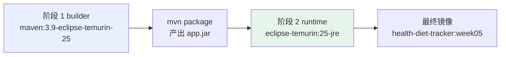
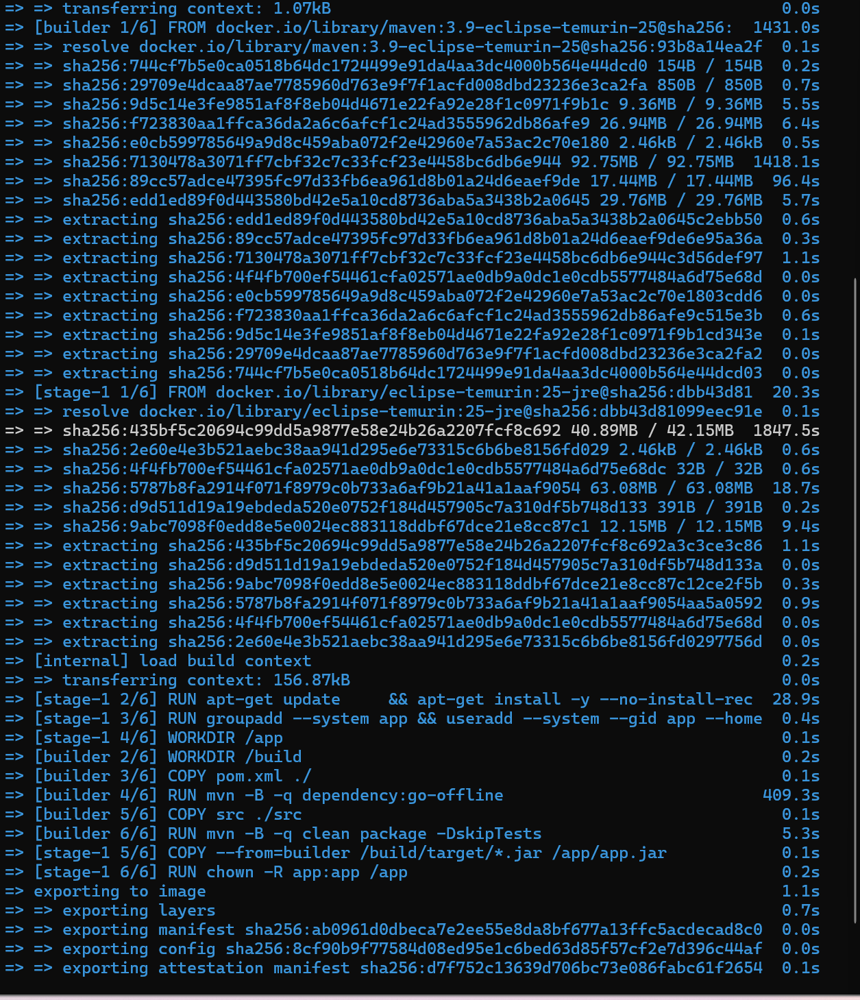
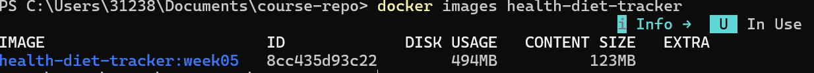
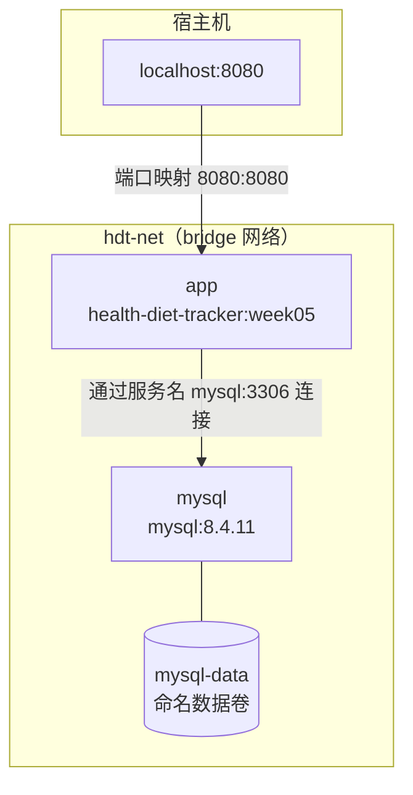
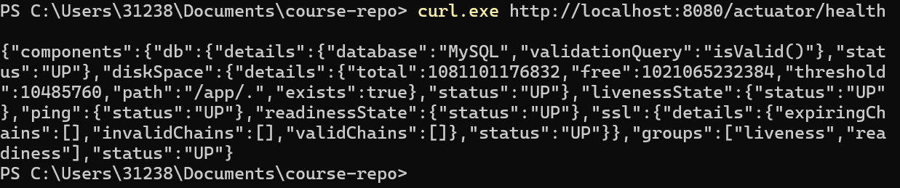
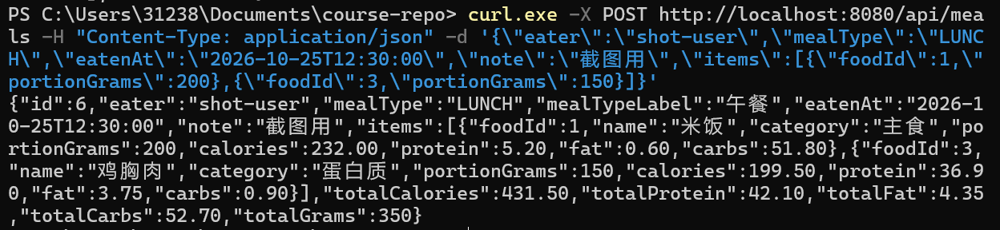
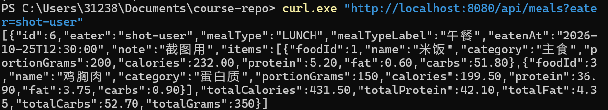
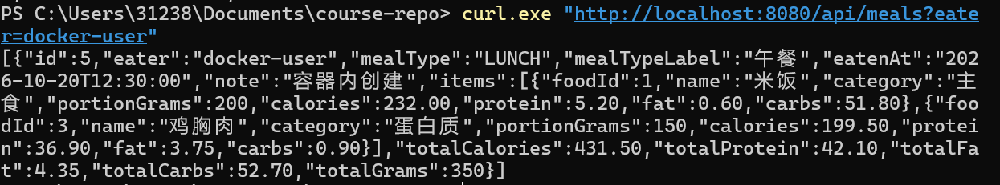
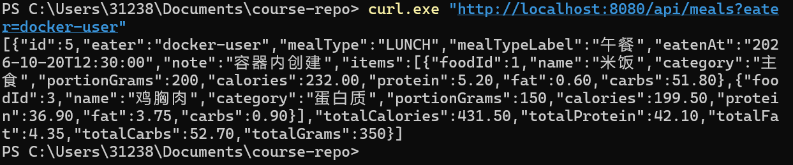

# Week 05 作业记录

> 个人健康饮食记录管理系统（Health & Diet Tracker）· 学号 2412190233 · 姓名 郑俊豪
> 本周任务：把第 04 周的单体应用与 MySQL 一起容器化，实现可重复的镜像构建、一键启动、
> 业务 API 验证与数据持久化验证。

---

## 本周目标

| 序号 | 任务 | 交付物 |
| :-- | :--- | :--- |
| 1 | Dockerfile 与镜像构建 | `monolith/Dockerfile`、`monolith/.dockerignore`，多阶段构建成功 |
| 2 | Compose 编排与启动 | 仓库根目录 `compose.yaml`、`.env.example`，`docker compose up -d --build` 两服务均运行 |
| 3 | 业务 API 验证 | 容器化应用的接口可访问，含创建与查询 |
| 4 | 数据持久化验证 | `docker compose down` 后 `up -d`，数据仍在 |
| 5 | 文档与证明材料 | 本文 + `screenshots/` |

---

## 一、Dockerfile 与镜像构建

### 1.1 多阶段构建的设计

`monolith/Dockerfile` 分两个阶段：



**为什么用多阶段**（这是本小题的核心考点）：

| 对比项 | 单阶段（直接用 Maven 镜像跑） | 多阶段（本实现） |
| :--- | :--- | :--- |
| 最终镜像内容 | 带 Maven、整个源码、本地依赖缓存 | 只有一个 JAR + JRE |
| 镜像体积 | 大（数百 MB 的构建工具链） | 小（仅运行期依赖） |
| 攻击面 | 容器内有编译工具与完整源码，泄露风险高 | 攻击者拿不到源码与构建工具 |
| 缓存利用 | — | 先 COPY pom.xml 下载依赖，改业务代码时不必重下依赖 |

其他关键写法：

| 写法 | 作用 |
| :--- | :--- |
| `COPY pom.xml` 后再 `mvn dependency:go-offline` | 把依赖下载单独成层，业务代码变更不会导致重新下载依赖 |
| `mvn clean package -DskipTests` | 单测在本地 `./mvnw test` 已跑过（75 个），镜像构建只负责产出 JAR |
| `groupadd` / `useradd` + `USER app` | **非 root 运行**，容器安全的基本要求 |
| `apt-get install curl` | app 的 healthcheck 要访问 Actuator，temurin 镜像默认不带 curl |
| `ENTRYPOINT ["java", "-jar", ...]` | exec 形式启动，java 是 PID 1，能正确接收 `docker stop` 的 SIGTERM |
| `-XX:MaxRAMPercentage=75.0` | 按容器内存上限计算堆大小，避免 JVM 忽略 cgroup 限制 |

### 1.2 构建命令

```powershell
# 在仓库根目录执行
docker build -t health-diet-tracker:week05 ./monolith
```

**构建结果**（真实输出，节选）：

```
[+] Building 1851.6s (18/18) FINISHED                        docker:desktop-linux
 => [internal] load metadata for docker.io/library/maven:3.9-eclipse-temurin-25    3.4s
 => [internal] load metadata for docker.io/library/eclipse-temurin:25-jre          3.4s
 => [builder 1/6] FROM docker.io/library/maven:3.9-eclipse-temurin-25         1431.0s
 => [builder 2/6] WORKDIR /build                                                0.2s
 => [builder 3/6] COPY pom.xml ./                                               0.1s
 => [builder 4/6] RUN mvn -B -q dependency:go-offline                         409.3s
 => [builder 5/7] COPY src ./src                                                0.1s
 => [builder 6/7] RUN mvn -B -q clean package -DskipTests                       5.3s
 => [builder 7/7] RUN ls -la target/*.jar                                       0.1s
 => [stage-1 1/6] FROM docker.io/library/eclipse-temurin:25-jre                 20.3s
 => [stage-1 2/6] RUN apt-get update && apt-get install -y curl                 28.9s
 => [stage-1 3/6] RUN groupadd --system app && useradd -g app app               0.4s
 => [stage-1 5/6] COPY --from=builder --chown=app:app .../app.jar /app/app.jar   0.1s
 => exporting to image                                                          1.1s
 => => naming to docker.io/library/health-diet-tracker:week05                    0.0s
```

**首次构建耗时约 31 分钟**，几乎全花在下载基础镜像与 Maven 依赖上
（`maven:3.9-eclipse-temurin-25` 的单个镜像层就用了 1431 秒）。
后续构建有层缓存与 BuildKit 的 Maven 仓库缓存，只需几十秒。
`dependency:go-offline` 用了 409 秒，而真正打包 `mvn package` 只用 5.3 秒 ——
这正说明"依赖层"与"业务层"分离的价值：只要 pom 不变，改业务代码不必重新下载依赖。

查看镜像：

```powershell
docker images health-diet-tracker
```

**镜像信息**（真实输出）：

```
REPOSITORY            TAG      IMAGE ID      SIZE
health-diet-tracker   week05   fdf6ce8d6b5b  580.8 MB
```

实际 580.8 MB（609145 千字节级），共 **10 层**。体积构成（`docker history` 实测）：

| 层 | 大小 |
| :--- | ---: |
| `eclipse-temurin:25-jre` 基础层（Ubuntu + JDK 25 运行环境） | ~201 MB + 基础系统层 |
| `app.jar`（fat JAR，含全部依赖） | 62.2 MB |
| `apt-get install curl` | 11.4 MB |
| 其它（groupadd/useradd/环境变量等） | < 1 MB |

> 镜像体积有一处优化值得记录：起初用 `RUN chown -R app:app /app` 改属主，
> `docker history` 显示这一层单独占 **62.2 MB** —— 因为改元数据会让 Docker
> 把 62 MB 的 jar 整层复制一遍，等于在镜像里存了两份。
> 改成 `COPY --chown=app:app`（拷贝同时设属主）后，镜像从 **693.4 MB / 11 层**
> 降到 **580.8 MB / 10 层**。

验证镜像里确实没有构建工具链与源码（多阶段构建的核心收益）：

```powershell
docker run --rm --entrypoint sh health-diet-tracker:week05 -c "ls -la /app; command -v mvn; command -v javac"
```

```
total 60780
-rw-r--r-- 1 app app 62230199 Oct 19 14:43 app.jar
无 mvn
无 javac
```

`/app` 下只有一个 62 MB 的 `app.jar`（属主 `app`），没有 `src/`、没有 `mvn`、没有 `javac`。

### 1.3 .dockerignore 的作用

排除 `target/`、`.git/`、IDE 配置、`docs/`、`.env` 等构建无关内容：

- 加快上下文传输（`target/` 可能有几十 MB）
- 避免把本地口令文件（`.env`）打进镜像
- 减少镜像层数

### 截图



这张截图应展示 `docker build` 从两个阶段一路成功到 `naming to ...:week05` 的输出。



这张截图应展示 `docker images health-diet-tracker` 的结果，能看到镜像大小。

---

## 二、Compose 编排与启动

### 2.1 编排结构



关键配置点：

| 配置 | 值 | 为什么这样写 |
| :--- | :--- | :--- |
| `services.app.build.context` | `./monolith` | 构建上下文指向应用所在目录 |
| `services.mysql.image` | `mysql:8.4.11` | 按要求使用该版本 |
| `ports`（app） | `"8080:8080"` | 宿主机可访问接口 |
| `MYSQL_URL` | `jdbc:mysql://mysql:3306/health_diet?...` | **用服务名 `mysql` 而不是 localhost**：容器内的 localhost 指自己 |
| `mysql` 的 `ports` | **不映射** | 数据库只在内部网络可达，不暴露到宿主机，更安全 |
| `volumes` | `mysql-data:/var/lib/mysql` | 命名数据卷，`down` 不删、只有 `-v` 才删 |
| `depends_on.mysql.condition` | `service_healthy` | 等 MySQL 健康检查通过再启动应用，避免启动竞态 |
| `healthcheck`（mysql） | `mysqladmin ping` | 判断数据库真的能接受连接 |
| `healthcheck`（app） | `curl /actuator/health` | 判断应用真的可服务 |
| `version` 字段 | **不使用** | 新版 compose 已废弃该字段，写了会告警 |

### 2.2 环境变量与口令管理

口令不写进 `compose.yaml`，而是注入方式：

```
.env.example   ← 提交到仓库的模板（口令是占位值）
.env           ← 本机实际使用，已在 .gitignore 中排除
```

compose 里的 `${MYSQL_PASSWORD:?...}` 表示"必须提供，否则拒绝启动"，
避免有人忘了配口令时应用默默用空口令连上数据库。

### 2.3 启动命令

```powershell
# 在仓库根目录
Copy-Item .env.example .env      # 然后编辑 .env，把两个口令改掉

docker compose up -d --build
docker compose ps
```

**启动结果**（真实输出）：

```
NAME        IMAGE                        STATUS                    PORTS
hdt-app     health-diet-tracker:week05   Up 21 seconds (healthy)   0.0.0.0:8080->8080/tcp, [::]:8080->8080/tcp
hdt-mysql   mysql:8.4.11                 Up 27 seconds (healthy)   3306/tcp, 33060/tcp
```

两个服务都是 `Up ... (healthy)`。启动顺序也能从容器日志看出：
`hdt-mysql Wait → hdt-mysql Healthy → hdt-app Starting` ——
这正是 `depends_on.condition: service_healthy` 在起作用，应用确实等数据库健康后才启动。

补充验证：容器内进程确实以非 root 身份运行。

```powershell
docker compose exec app id
# uid=999(app) gid=999(app) groups=999(app)
```

数据卷也确认存在：

```powershell
docker volume ls | Select-String hdt
# local     hdt-mysql-data
```

### 截图


这张截图应展示 `docker compose up -d --build` 的完成输出。


这张截图应展示 `docker compose ps`，两个服务均为 running/healthy。

---

## 三、业务 API 验证

通过端口映射访问容器化应用，覆盖健康检查 + 一次创建 + 一次查询。

```powershell
# 1) 健康检查
curl.exe http://localhost:8080/actuator/health

# 2) 查询（读）
curl.exe "http://localhost:8080/api/meals?eater=demo-user"

# 3) 创建（写）
curl.exe -X POST http://localhost:8080/api/meals -H "Content-Type: application/json" -d '{\"eater\":\"docker-user\",\"mealType\":\"LUNCH\",\"eatenAt\":\"2026-10-20T12:30:00\",\"note\":\"容器内创建\",\"items\":[{\"foodId\":1,\"portionGrams\":200},{\"foodId\":3,\"portionGrams\":150}]}'

# 4) 再查一次，确认写进去了
curl.exe "http://localhost:8080/api/meals?eater=docker-user"
```

**验证结果**（真实输出节选）：

健康检查返回 200，**关键点是 `"database":"MySQL"`** ——
证明容器里的应用真的连上了 MySQL 服务，而不是退化成 H2：

```json
{
  "components": {
    "db": { "details": { "database": "MySQL", "validationQuery": "isValid()" }, "status": "UP" },
    "diskSpace": { "status": "UP" },
    "ping": { "status": "UP" },
    "readinessState": { "status": "UP" }
  },
  "status": "UP"
}
```

创建一餐（米饭 200g + 鸡胸肉 150g）返回 **201**，服务端算出的合计与预期一致：

```json
{
  "id": 5,
  "eater": "docker-user",
  "mealTypeLabel": "午餐",
  "items": [
    { "foodId": 1, "name": "米饭",   "portionGrams": 200, "calories": 232.00 },
    { "foodId": 3, "name": "鸡胸肉", "portionGrams": 150, "calories": 199.50 }
  ],
  "totalCalories": 431.50,
  "totalProtein": 42.10,
  "totalFat": 4.35,
  "totalCarbs": 52.70,
  "totalGrams": 350
}
```

再按 `eater=docker-user` 查询，能读回同一条记录（`id=5`，`totalCalories 431.50`）。

顺带验证业务规则在容器里同样生效 —— 提交 2000g 米饭（2320 kcal）返回 **422**：

```json
{
  "status": 422,
  "code": "BUSINESS_RULE_VIOLATION",
  "message": "本次用餐热量 2320.00 kcal 超过单餐上限 1500 kcal，请调整份量或拆分为多条记录",
  "details": ["违反规则：R3 —— 单次用餐热量不得超过 1500 kcal"]
}
```

容器内查询示例数据也正确：`GET /api/meals/daily-summary?eater=demo-user&date=2026-09-28`
返回 `mealCount: 4`、`totalCalories: 1497.40`、四个餐次各 1 条
（早餐 409.30 / 午餐 482.50 / 晚餐 455.60 / 加餐 150.00），与 MySQL 环境下的结果完全一致。

### 截图



这张截图应展示 `curl /actuator/health` 返回 `"status":"UP"`，且能看到请求地址。



这张截图应展示 POST 请求返回 201 与响应体（含 totalCalories）。



这张截图应展示按 eater 查询到刚创建的记录。

---

## 四、数据持久化验证

验证目标：**容器被删除重建后，数据仍然存在**。这依赖命名数据卷。

```powershell
# 1) 记下当前数据量
curl.exe "http://localhost:8080/api/meals?eater=docker-user"

# 2) 删除容器（注意：不加 -v，数据卷保留）
docker compose down

# 3) 重新启动（不加 --build，直接用已有镜像）
docker compose up -d

# 4) 等应用就绪后再查同一条记录
curl.exe "http://localhost:8080/api/meals?eater=docker-user"
```

**关键点**：

- `docker compose down` 删除的是**容器**，命名数据卷 `hdt-mysql-data` 保留
- `docker compose down -v` 会连数据卷一起删 —— **这一步不能用于持久化验证**，
  否则数据本就该没了，验证不出任何东西
- 重建后查到的记录 ID 与关键字段应与 down 之前一致

**验证结果**（真实输出）：

`down` 之前，`docker-user` 名下有一条记录：

```json
[{ "id": 5, "eater": "docker-user", "mealTypeLabel": "午餐",
   "eatenAt": "2026-10-20T12:30:00", "totalCalories": 431.50, "totalGrams": 350 }]
```

执行 `docker compose down` 后，容器与网络都被删除，但数据卷仍在：

```
 Container hdt-mysql Stopped
 Container hdt-mysql Removed
 Network   hdt-net     Removed

docker volume ls  ->  local     hdt-mysql-data      ← 卷还在
```

再执行 `docker compose up -d`，等待 healthy 后查询同一个 eater：

```json
[{ "id": 5, "eater": "docker-user", "mealTypeLabel": "午餐",
   "eatenAt": "2026-10-20T12:30:00", "totalCalories": 431.50, "totalGrams": 350 }]
```

**`id` 仍是 5，`totalCalories` 仍是 431.50，内容完全一致** ——
说明数据存在命名数据卷里，容器重建不影响数据。

另有一个细节可以佐证"数据没有重复写入"：应用每次启动都会执行
`schema.sql` 与 `data.sql`，由于脚本是幂等的（`CREATE TABLE IF NOT EXISTS`
与 `INSERT IGNORE`），重建后 `food` 仍是 12 条、`meal_record` 仍是 4 条种子数据，
不会因为多启动一次就翻倍。

### 截图



这张截图应展示 `docker compose down` 之前查询到的记录。



这张截图应展示 `docker compose down` → `up -d` 之后，同一条记录仍然存在且 ID 不变。

---

## 五、本周遇到的问题与解决办法

### 5.1 Docker Hub 连不上，无法拉取镜像

- **现象**：`docker run mysql:8.4` 报
  `failed to do request: ... dial tcp xxx:443: connectex: A connection attempt failed`，
  `docker compose up` 同样卡在拉取基础镜像。
- **原因**：本机到 `registry-1.docker.io` / `auth.docker.io` 的连接超时（无代理）。
- **解决**：给 Docker 配置镜像加速站。在 `~/.docker/daemon.json` 中加入：

  ```json
  {
    "registry-mirrors": ["https://docker.1panel.live"]
  }
  ```

  重启 Docker Desktop 后用 `docker info` 确认 `Registry Mirrors` 已生效。
  选这个站是因为实测它能提供所需的三个镜像：`maven:3.9-eclipse-temurin-25`、
  `eclipse-temurin:25-jre`、`mysql:8.4.11`（均返回 HTTP 200）。

### 5.2 运行镜像默认不含 curl（设计时提前规避）

- **背景**：compose 里 app 的 healthcheck 用 `curl` 访问 `/actuator/health`。
- **问题**：`eclipse-temurin:25-jre` 基于 Ubuntu 精简镜像，**默认不含 curl**。
  如果不装，健康检查永远失败，app 会一直显示 `unhealthy` —— 而应用本身其实是好的，
  这种"假故障"最难排查。
- **处理**：构建时就装上，不等到出问题再补：

  ```dockerfile
  RUN apt-get update \
      && apt-get install -y --no-install-recommends curl \
      && rm -rf /var/lib/apt/lists/*
  ```

  `--no-install-recommends` 与清空 apt 索引是为了不把包管理器缓存留在镜像里。

### 5.3 compose 里的 localhost 指的是容器自己（设计要点）

- **要点**：容器网络是隔离的，应用容器里的 `localhost` 指向它自己，不是数据库容器。
  若把 `MYSQL_URL` 写成 `jdbc:mysql://localhost:3306/...`，应用会去连自己的 3306 端口，
  得到 connection refused。
- **做法**：一律用 compose 服务名作主机名 —— `jdbc:mysql://mysql:3306/health_diet`。
  同一网络内 DNS 会把 `mysql` 解析到数据库容器。

### 5.4 没有 `version` 字段

新版 Docker Compose 已废弃 compose 文件顶层的 `version` 字段，
写上会输出 `WARN ... the attribute 'version' is obsolete`。本实现不写该字段。

### 5.5 schema.sql 用了 MySQL 不支持的建索引语法

- **现象**：`docker compose ps` 里 `hdt-app` 一直 `Restarting (1)`，而 `hdt-mysql` 正常 healthy。
- **原因**：`schema.sql` 里写了

  ```sql
  CREATE INDEX IF NOT EXISTS idx_meal_record_eater_time ON meal_record (eater, eaten_at);
  ```

  `IF NOT EXISTS` 是 PostgreSQL / SQLite 的语法，**MySQL 不支持**，
  执行到这一句就报语法错误，`spring.sql.init` 随之中止，应用启动失败。
  更麻烦的是这个脚本在失败前已经建好了前两张表，数据库处于"半成品"状态。
- **为什么之前没发现**：先前用 H2（连接串带 `MODE=MySQL`）验证过这份脚本，H2 接受该语法。
  **H2 的"MySQL 兼容模式"只模拟了部分行为，不等于 MySQL** ——
  凡是依赖真实数据库特性的地方，最终必须在真实 MySQL 上过一遍。
- **解决**：把索引改成 `CREATE TABLE` 的内联定义，MySQL 与 H2 都支持，且天然幂等：

  ```sql
  CREATE TABLE IF NOT EXISTS meal_record (
      ...
      INDEX idx_meal_record_eater_time (eater, eaten_at)
  );
  ```

  表不存在时索引随表一起建；表已存在时整条语句跳过。
  修复后还必须 `docker compose down -v` 清空那个"半成品"数据库再重新启动，
  否则已存在的表会让 `CREATE TABLE IF NOT EXISTS` 直接跳过，索引仍然加不上。

### 5.6 镜像里拷错了 jar：`no main manifest attribute`

- **现象**：容器日志反复输出

  ```
  no main manifest attribute, in /app/app.jar
  ```

  应用秒退，`docker compose ps` 显示 `Restarting (1)`。
- **原因**：`pom.xml` 里为了给单元测试传 Mockito agent，用 `maven-dependency-plugin`
  把 `mockito-core.jar` 复制到了 **`target/` 根目录**。而 Dockerfile 里写的是

  ```dockerfile
  COPY --from=builder /build/target/*.jar /app/app.jar
  ```

  此时 `target/` 下有两个 jar：`health-diet-tracker-*.jar`（fat JAR）与
  `mockito-core.jar`（不含 `Main-Class`）。通配符把不该要的也带进了镜像。
- **隐蔽之处**：本地 `mvn package` 完全正常，`target/*.jar` 在本地看不出问题，
  只有在 Docker 拷贝产物这一刻才暴露。
- **解决**：四步一起做，彻底消除歧义

  1. `maven-dependency-plugin` 的输出目录改为 `target/mockito-agent/`，不再污染 `target/` 根；
  2. `pom.xml` 加 `<finalName>app</finalName>`，把产物名固定；
  3. Dockerfile 改为精确拷贝 `COPY --from=builder /build/target/app.jar /app/app.jar`；
  4. 构建日志里加一步 `RUN ls -la target/*.jar`，把产物大小打出来 ——
     如果 `app.jar` 只有几十 KB，说明 repackage 没生效，能立刻在构建阶段发现，
     不用等到容器反复重启才排查。

  同时给 `spring-boot-maven-plugin` 显式补上 `repackage` execution 与 `mainClass`，
  不依赖 parent POM 的隐式配置。

- **验证**：修复后 `target/app.jar` 为 59.35 MB，`unzip` 出的 `MANIFEST.MF` 含
  `Main-Class: org.springframework.boot.loader.launch.JarLauncher` 与
  `Start-Class: com.zjgsu.hdt.HealthDietTrackerApplication`。

### 5.7 chown 让 62 MB 的 jar 在镜像里存了两份

- **现象**：`docker history` 里 `RUN chown -R app:app /app` 单独占 62.2 MB，
  与 `COPY app.jar` 那一层一样大。
- **原因**：`chown` 修改文件属主属于元数据变更，Docker 的层是不可变的，
  因此必须把整个文件复制到新的一层 —— 62 MB 的 jar 就这样存了两份。
- **解决**：改用 `COPY --chown=app:app`，在拷贝的同时设置属主，省掉一整层。

---

## 六、完成内容小结

| 作业要求 | 完成情况 |
| :--- | :--- |
| 多阶段构建的 Dockerfile | `monolith/Dockerfile`，builder 用 Maven 镜像、runtime 用 JRE 镜像 |
| `.dockerignore` 排除构建产物/IDE/密码文件 | `monolith/.dockerignore` |
| `compose.yaml` 放仓库根目录 | 已放 |
| 至少包含 app 与 mysql 服务，MySQL 8.4.11 | `app`（构建上下文 `./monolith`）+ `mysql:8.4.11` |
| 应用端口映射、共享网络、通过服务名连 MySQL | `8080:8080`、`hdt-net`、`jdbc:mysql://mysql:3306/...` |
| 命名数据卷保存 MySQL 数据 | `mysql-data` → `/var/lib/mysql` |
| 环境变量配连接/账号/密码 + `.env.example` + `.gitignore` | 三项齐全，`.env` 已忽略 |
| MySQL 健康检查，应用等数据库健康后启动 | `healthcheck` + `condition: service_healthy` |
| 不使用已废弃的 version 字段 | 未使用 |
| 业务 API 验证 | 健康检查 + 创建 + 查询 |
| 数据持久化验证 | `down` 后 `up -d`，数据仍在 |
| README 提供可复制命令 | 见 README「容器化运行」一节 |

---

## 七、后续计划

| 周次 | 计划 | 落点 |
| :--- | :--- | :--- |
| Week 06 | 微服务拆分起步 | 把用户/记录/分析按现有 `service` 包边界拆成独立服务 |
| 后续 | 服务注册与网关 | 引入注册中心与统一入口 |
| 后续 | 可观测性 | 在 Actuator 基础上补 Micrometer 指标与链路追踪 |
| 后续 | CI/CD | 镜像构建与推送自动化 |
