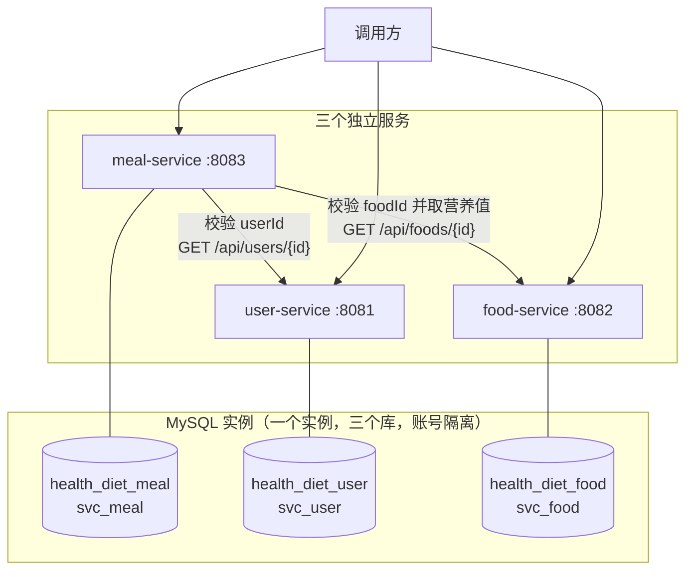
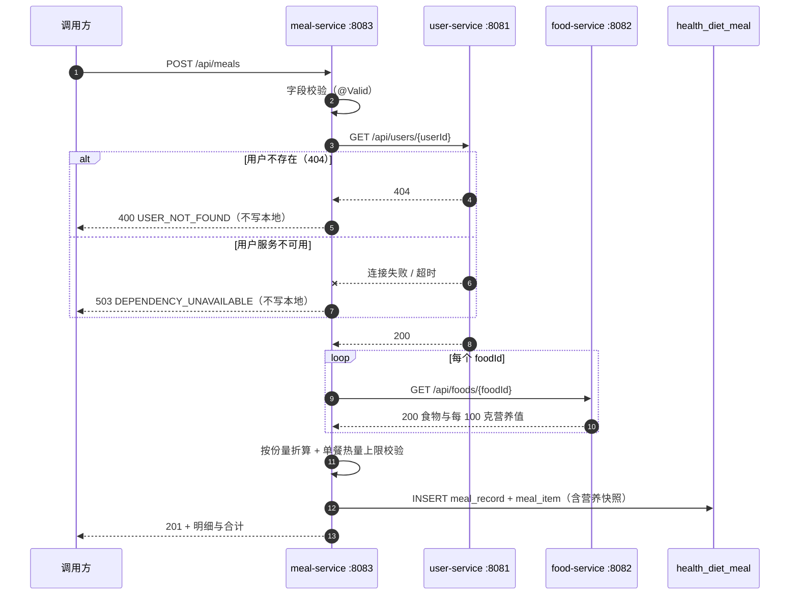

# Week 06 作业记录

> 个人健康饮食记录管理系统（Health & Diet Tracker）· 学号 2412190233 · 姓名 郑俊豪
> 本周任务：把第 04/05 周的单体应用拆成三个独立微服务，完成服务边界设计、独立数据访问、
> 基础 HTTP 通信与本地容器编排。

---

## 本周目标

| 序号 | 任务 | 交付物 |
| :-- | :--- | :--- |
| 1 | 服务拆分设计 | `docs/microservices-design.md`（含 Mermaid 架构图） |
| 2 | 微服务代码 | `services/user-service`、`services/food-service`、`services/meal-service` |
| 3 | 本地编排 | 仓库根目录 `compose.yaml`、`db/init/01-init-databases.sh` |
| 4 | 验证 | `scripts/smoke-test.sh`、本文 + `screenshots/` |

---

## 一、服务拆分设计

完整设计见 **[docs/microservices-design.md](../../microservices-design.md)**，这里只列结论。

### 1.1 单体模块 → 微服务 的映射

| 单体中的模块 | 拆分去向 | 拆分理由 |
| :--- | :--- | :--- |
| `Food` / `FoodRepository` / `FoodService` / `FoodController` | **food-service** :8082 | 营养基准数据，读多写少，被"记录"依赖但无反向依赖 |
| 原本只是 `MealRecord.eater` 字符串的用户概念 | **user-service** :8081 | 独立用户档案与每日热量目标；记录只存 `user_id` |
| `MealRecord` / `MealItem` / `MealRecordService` / `MealController` | **meal-service** :8083 | 高频写入的业务数据，也是唯一需要跨服务校验的一环 |
| `DailySummaryService` | 留在 meal-service | 只读自己的数据，暂不单独拆 |

### 1.2 三个服务的职责、端口与数据归属

| 服务 | 端口 | 独立数据库 | 拥有的表 | 数据库账号 |
| :--- | :--- | :--- | :--- | :--- |
| user-service | 8081 | `health_diet_user` | `app_user` | `svc_user` |
| food-service | 8082 | `health_diet_food` | `food` | `svc_food` |
| meal-service | 8083 | `health_diet_meal` | `meal_record`、`meal_item` | `svc_meal` |

三个库建在**同一个 MySQL 实例**里（作业允许），但**授权互相隔离**：
`svc_meal` 没有 `health_diet_user` 与 `health_diet_food` 的任何权限，
想拿用户或食物数据只能通过 HTTP 调用对应服务 —— 这才是"服务拥有自己的数据"。

### 1.3 服务之间的调用关系



**依赖是单向的**：`meal → user`、`meal → food`；user 与 food 互不依赖，也不反向依赖 meal。
因此前两个服务可以独立启动与升级，只有 meal 需要另外两个可用。

### 1.4 跨服务只存 ID，不建跨库外键

`meal_record.user_id` 与 `meal_item.food_id` 都是**普通列，没有外键**：

- 用户数据在 `health_diet_user`，食物数据在 `health_diet_food`，跨库外键在物理上不可能；
- 存在性由应用层调用对方接口校验（`MealRecordService` 里的 `userClient.requireUser` 与 `foodClient.requireFood`）；
- 真正的外键只有 `meal_item.meal_record_id → meal_record`（同库同服务）。

---

## 二、代码拆分

### 2.1 目录结构

```
services/
├── user-service/          独立 Spring Boot 工程
│   ├── pom.xml            独立 pom（不继承仓库内其他模块）
│   ├── Dockerfile         独立镜像构建
│   └── src/
│       ├── main/java/com/zjgsu/hdt/user/
│       │   ├── UserServiceApplication.java
│       │   ├── controller/UserController.java
│       │   ├── service/UserService.java
│       │   ├── repository/UserRepository.java
│       │   ├── model/AppUser.java
│       │   ├── dto/UserRequest.java, UserResponse.java
│       │   └── exception/（ResourceNotFoundException / ApiError / GlobalExceptionHandler）
│       ├── main/resources/
│       │   ├── application.yml
│       │   ├── schema.sql
│       │   └── data.sql
│       └── test/（UserServiceApplicationTests）
├── food-service/          同上结构（Food / FoodController / FoodService / …）
└── meal-service/          同上结构，额外含 client/ 与 config/
    └── src/main/java/com/zjgsu/hdt/meal/
        ├── client/UserClient.java, FoodClient.java, UserInfo.java, FoodInfo.java
        ├── config/HttpClientConfig.java
        └── service/MealRecordService.java   ← 跨服务流程在这里
```

每个服务都包含作业要求的：**独立 pom**、**独立配置**、**至少 1 个控制器**、**至少 1 个 service**、**至少 1 个测试**。

### 2.2 跨服务业务流程：记录一餐

`POST /api/meals` 是本周要求的完整跨服务流程，处理顺序刻意设计成"先校验、后写库"：



**两条硬规则**（作业明确要求）：

1. 依赖资源不存在 → **400**，且不写本地库；
2. 依赖服务不可用 → **503**，且不写本地库，**绝不跳过校验继续写**。

### 2.3 服务地址写在配置里，可被环境变量覆盖

`services/meal-service/src/main/resources/application.yml`：

```yaml
services:
  user-service:
    url: ${USER_SERVICE_URL:http://localhost:8081}
  food-service:
    url: ${FOOD_SERVICE_URL:http://localhost:8082}
  connect-timeout-ms: ${SERVICE_CONNECT_TIMEOUT_MS:2000}
  read-timeout-ms: ${SERVICE_READ_TIMEOUT_MS:3000}
```

- 默认值指向 `localhost`，本地单独调试时零配置；
- compose 里覆盖成 `http://user-service:8081`（**用服务名，不用 localhost**）；
- **超时必须显式配置**：`RestTemplate` 默认无限等待，一个依赖卡住就会占满请求线程，
  进而拖垮本服务 —— 这是拆分后最典型的连锁故障。

### 2.4 错误码设计

| 状态码 | 错误码 | 含义 | 调用方该怎么办 |
| :--- | :--- | :--- | :--- |
| 400 | `USER_NOT_FOUND` | 引用的用户不存在 | 改请求 |
| 400 | `FOOD_NOT_FOUND` | 引用的食物不存在 | 改请求 |
| 400 | `VALIDATION_FAILED` | 参数格式不合法 | 改请求 |
| 404 | `RESOURCE_NOT_FOUND` | 记录本身不存在 | 改请求 |
| 422 | `BUSINESS_RULE_VIOLATION` | 格式合法但违反业务规则 | 改数据 |
| 503 | `DEPENDENCY_UNAVAILABLE` | 依赖服务连不上 / 超时 | 稍后重试 |

用 **503** 而不是 500：这不是本服务的 bug，而是下游暂时不可用，语义要能区分开。

### 2.5 测试

| 服务 | 测试类 | 用例数 | 覆盖点 |
| :--- | :--- | ---: | :--- |
| user-service | `UserServiceApplicationTests` | 5 | 上下文装配、种子数据、按 ID 查询、不存在分支、创建与重名拒绝 |
| food-service | `FoodServiceApplicationTests` | 5 | 同上 + 分类过滤 |
| meal-service | `MealRecordServiceTests` | 7 | **跨服务成功路径**、用户不存在、食物不存在、user 不可用、food 不可用、业务规则、上下文 |
| 合计 | | **17** | |

meal-service 的测试用 `MockRestServiceServer` 绑在**真实** `RestTemplate` 上，
因此测到的是真实的 HTTP 客户端行为（404 与连不上被区分成两种错误），
而不是把客户端整个 mock 掉。每个失败用例都断言"本地记录数没有增加"。

运行方式（各服务目录下）：

```bash
mvn test
# 或使用仓库自带的 wrapper
./mvnw test
```

> 测试用 H2 内存库（`@ActiveProfiles("test")`），不需要本机装 MySQL。

### 2.6 截图


这张截图展开 `services/` 目录树，展示三个独立工程各有自己的 `pom.xml` 与 `src/`，
旁边的 `monolith/` 保持原样未被改动。


这张截图展示 `MealRecordService.create()` 里 ①–⑤ 五步注释，体现"先校验、后写库"的顺序。


这张截图展示 `UserClient.requireUser()` 的 catch 顺序：
404 翻译成 `USER_NOT_FOUND`，其余异常翻译成 `DEPENDENCY_UNAVAILABLE`。


这张截图展示 `application.yml` 里的 `services:` 段 —— 地址可被环境变量覆盖，超时显式配置。


这张截图展示三个服务分别 `mvn test` 的结果，共 17 个测试全部通过。

---

## 三、本地编排

### 3.1 一键启动

```powershell
# 仓库根目录
Copy-Item .env.example .env      # 然后把所有 change-me-... 改成自己的口令
docker compose up -d --build
docker compose ps
```

### 3.2 编排要点

| 要求 | 实现 |
| :--- | :--- |
| 一键启动所有服务与数据库 | `docker compose up -d --build` 启动 1 个 MySQL + 3 个服务 |
| 每个服务独立数据库和账号 | `db/init/01-init-databases.sh` 建 3 个库 + 3 个账号，授权互相隔离 |
| 不能跨服务读写数据表 | 账号层面就没有权限；代码里也没有跨库 Repository |
| 配置数据卷保留数据 | 命名卷 `hdt-mysql-data` → `/var/lib/mysql`，`down` 不删，`down -v` 才删 |
| 容器间通过 Compose 服务名通信 | `DB_URL` 用 `mysql:3306`，`USER_SERVICE_URL` 用 `http://user-service:8081`，不用 localhost |
| 依赖顺序 | mysql healthy → user/food 启动 → meal 等服务健康后才启动 |

### 3.3 端口约定

| 服务 | 宿主机端口 | 说明 |
| :--- | ---: | :--- |
| user-service | 8081 | 可直接 curl 调试 |
| food-service | 8082 | 同上 |
| meal-service | 8083 | 同上 |
| mysql | **不映射** | 数据库只在容器网络内可达，不暴露到宿主机 |
| 单体版本（profile） | 8080 | `docker compose --profile monolith up -d --build` |

### 3.4 从第 05 周切换过来要注意

MySQL 官方镜像的 `/docker-entrypoint-initdb.d/` 脚本**只在数据目录为空时执行**。
如果 `mysql-data` 卷里已经有第 05 周的数据，初始化脚本不会运行，三个微服务的库与账号就不会被创建。
因此第一次切到第 06 周需要执行一次：

```powershell
docker compose down -v      # 删掉旧数据卷（第 05 周的演示数据会丢，属于预期）
docker compose up -d --build
```

之后正常 `down` / `up` 都不会再触发初始化，数据也能持久保留。

### 3.5 截图


这张截图展示 `docker compose ps`：mysql 与三个微服务共四个容器，全部 `healthy`。


这张截图展示 `compose.yaml` 里 mysql 的 `volumes`、三个服务的 `environment` 与 `depends_on`，
体现数据卷、服务名通信与健康检查依赖。

---

## 四、验证

### 4.1 冒烟脚本

`scripts/smoke-test.sh` 可从仓库根目录直接运行：

```bash
bash scripts/smoke-test.sh
```

它覆盖五组用例：

| 用例 | 验证内容 | 期望 |
| :--- | :--- | :--- |
| 0 | 三个服务的健康接口 | 均 `"status":"UP"` |
| 1 | 跨服务业务流程：记录一餐（userId=1，foodId=1 与 3） | 201，合计 431.50 kcal，本地记录数 +1 |
| 2 | 用户不存在（userId=9999） | 400 `USER_NOT_FOUND`，本地记录数不变 |
| 3 | 食物不存在（foodId=9999） | 400 `FOOD_NOT_FOUND`，本地记录数不变 |
| 4 | 单餐热量超限（2000g 米饭 = 2320 kcal） | 422 `BUSINESS_RULE_VIOLATION`，本地记录数不变 |
| 5 | 依赖服务不可用（`docker compose stop user-service`） | 503 `DEPENDENCY_UNAVAILABLE`，本地记录数不变；随后自动恢复服务 |

### 4.2 运行结果

**冒烟脚本**（在 `hdt-net` 网络内运行，用例 5 因容器内没有 docker CLI 而跳过，见下方单独验证）：

```
==============================================================
  开始前检查：三个服务的健康接口
==============================================================
  [PASS] user-service 健康检查 UP（http://user-service:8081）
  [PASS] food-service 健康检查 UP（http://food-service:8082）
  [PASS] meal-service 健康检查 UP（http://meal-service:8083）

==============================================================
  用例 1：跨服务业务流程 —— 记录一餐（会调用 user + food 两个服务）
==============================================================
  记录前 userId=1 的记录数：4
  [PASS] POST /api/meals 创建成功（HTTP 201）
  [PASS] 响应含合计热量 431.50（米饭 232 + 鸡胸肉 199.5）
  [PASS] 明细里带食物名称快照
  [PASS] 本地库记录数增加（4 → 5）

==============================================================
  用例 2：依赖资源不存在 —— 用户不存在（应 400，且不写本地库）
==============================================================
  [PASS] userId=9999 被拒绝（HTTP 400）
  [PASS] 错误码为 USER_NOT_FOUND
  [PASS] 未写本地库（userId=9999 的记录数为 0）

==============================================================
  用例 3：依赖资源不存在 —— 食物不存在（应 400，且不写本地库）
==============================================================
  [PASS] foodId=9999 被拒绝（HTTP 400）
  [PASS] 错误码为 FOOD_NOT_FOUND
  [PASS] 未写本地库（记录数保持 5）

==============================================================
  用例 4：业务规则 —— 单餐热量超过 1500 kcal（应 422，且不写本地库）
==============================================================
  [PASS] 2000g 米饭（2320 kcal）被拒绝（HTTP 422）
  [PASS] 错误码为 BUSINESS_RULE_VIOLATION
  [PASS] 未写本地库（记录数保持 5）

==============================================================
  结果汇总
==============================================================
  通过：16
  失败：0

  全部通过 ✅
```

**用例 5 单独在宿主机验证**（`docker compose stop user-service` 之后）：

```json
{
  "status": 503,
  "error": "Service Unavailable",
  "code": "DEPENDENCY_UNAVAILABLE",
  "message": "依赖服务不可用：user-service（ResourceAccessException: I/O error on GET request for \"http://user-service:8081/api/users/1\": Connect timed out）；本次请求未写入任何数据，可稍后重试",
  "path": "/api/meals"
}
```

| 时刻 | userId=1 的记录数 |
| :--- | ---: |
| 停服务前 | 5 |
| 503 失败之后 | **5（未变）** |
| `docker compose start user-service` 后 6 秒 | 恢复 UP |

注意错误信息里的两个细节：一是明确指出了是 **user-service** 不可用（而不是笼统的"内部错误"），
二是明确告诉调用方**本次没有写入任何数据**，可以放心重试。

### 4.2.1 数据隔离的实际验证

设计里声称"三个账号互相读不到对方的库"，这是可以实际验证的：

```powershell
# 三个账号的授权（只列出各自的库）
docker exec hdt-mysql mysql -uroot -p<root_pwd> -N -e "SHOW GRANTS FOR 'svc_meal'@'%'"
#   GRANT USAGE ON *.* TO `svc_meal`@`%`
#   GRANT ALL PRIVILEGES ON `health_diet_meal`.* TO `svc_meal`@`%`

# svc_meal 尝试读 user 库 → 被数据库层拒绝
docker exec hdt-mysql mysql -usvc_meal -p<meal_pwd> -e "SELECT COUNT(*) FROM health_diet_user.app_user"
#   ERROR 1142 (42000): SELECT command denied to user 'svc_meal'@'localhost' for table 'app_user'

# svc_user 尝试读 meal 库 → 同样被拒绝
docker exec hdt-mysql mysql -usvc_user -p<user_pwd> -e "SELECT COUNT(*) FROM health_diet_meal.meal_record"
#   ERROR 1142 (42000): SELECT command denied to user 'svc_user'@'localhost' for table 'meal_record'

# 读自己的库 → 正常
docker exec hdt-mysql mysql -usvc_meal -p<meal_pwd> -e "SELECT COUNT(*) FROM meal_record" health_diet_meal
#   4
```

这就是"服务只能访问自己的数据"在**数据库权限层**的落实 ——
不是靠代码约定，而是靠授权，代码写错了也读不到。

### 4.3 关于"远端成功、本地失败"窗口

这是作业要求说明的重点。按发生顺序列举本周方案里的三个窗口：

**窗口 A：校验都成功，但本地 INSERT 失败**

`user-service` 与 `food-service` 都已返回成功，接着写 `meal_record` 时数据库抖动/磁盘满导致失败。
结果是：远端查询成功了，本地没留下记录。

- 客户端收到 500，不会误以为成功；
- 由于没有分布式事务，无法"回滚"已经完成的两次只读查询 —— 但只读查询没有副作用，实际不需要回滚；
- **本接口可以安全重试**：写入失败时本地什么都没留下，重试不会产生重复数据。

**窗口 B：校验通过后、写入前，对方数据被删（TOCTOU）**

`meal-service` 校验时用户存在，但在写入之前用户被删除，于是记录里留下一个
**指向已不存在用户的 `user_id`**。

- 本轮**不做补偿**（作业明确不要求跨服务原子事务、自动补偿或消息机制）；
- 处理方式是接受最终一致：记录仍能落库，但查询时无法保证补全用户名；
- 若将来需要强一致，正确方向是引入事件 + 重试/对账，或改成"用户删除时发事件、meal 侧软删除引用"。

**窗口 C：food 在校验后被下线**

记录里已保存了食物名称与营养值的**快照**，因此历史记录仍能正常展示，
不会因为食物被删除而显示成空值。代价是食物库后来改值，历史记录不跟着变 ——
对"饮食记录"这个业务，历史时刻的营养值本来就该是当时的值，这个取舍是可接受的。

**结论**：本方案在失败方向上始终是"宁可拒绝，也不写入不完整的数据"。
真正的残留风险只有窗口 B（悬垂的 `user_id`），且它是可检测的（能通过与 user-service 对账发现），
不是静默的数据损坏。

### 4.4 验证方法小结

| 要证明的事 | 怎么证明 |
| :--- | :--- |
| 三个服务真的独立 | 三个独立 `pom.xml`，分别 `mvn test` 通过；`docker compose ps` 三个容器各自 healthy |
| 数据真的隔离 | 三个库、三个账号，账号只被授权自己的库；代码里没有跨库 Repository |
| 跨服务真的走 HTTP | `MealRecordService` 通过 `RestTemplate` 调 `UserClient` / `FoodClient`，日志可见实际 URL |
| 失败不写本地 | smoke-test 每个失败用例都比对 meal-service 的记录数 |
| 依赖不可用有明确错误 | 停掉 user-service 后返回 503 `DEPENDENCY_UNAVAILABLE` 且提示具体服务名 |

### 4.5 截图


这张截图展示 `SHOW GRANTS` 与 `svc_meal` 读 `health_diet_user` 被拒绝（`ERROR 1142`），
证明数据隔离落在数据库权限层，不靠代码自觉。


这张截图展示 `scripts/smoke-test.sh` 的输出：16 项通过、0 失败。


这张截图展示 `POST /api/meals` 返回 201 与 `totalCalories:431.50` ——
这条记录是 meal-service 先调 user-service 校验用户、再调 food-service 取营养值之后才写入的。


这张截图展示停掉 user-service 后返回 **503 `DEPENDENCY_UNAVAILABLE`**，
错误信息里明确指出是 user-service 不可用、且本次请求没有写入任何数据。

---

## 五、本周遇到的问题与解决办法

### 5.1 测试相互污染导致断言失败

- **现象**：food-service 的测试单独跑通过，一起跑时报"期望 12 条食物，实际 13 条"。
- **原因**：`createFoodPersists` 会真的插入一条记录，而 `contextLoads` 断言的是绝对条数 12。
  JUnit 默认执行顺序不是源码顺序，于是结果随顺序变化。
- **解决**：给 `@SpringBootTest` 加 `@Transactional`，每个测试方法结束后回滚，
  各用例互不影响。meal-service 的测试则刻意**不加**事务 —— 因为要用"前后行数"证明"没有写入"，
  必须让写入真的落库；那种情况下所有断言都改成相对行数（只比较前后差值）。

### 5.2 单体与微服务共用同一个 MySQL 实例时，初始化脚本不执行

- **现象**：从第 05 周切过来后，三个微服务连不上数据库，报"未知数据库"或"访问被拒"。
- **原因**：MySQL 镜像的 `/docker-entrypoint-initdb.d/` 脚本**只在数据目录为空时执行一次**。
  `mysql-data` 卷里已有第 05 周的数据，脚本被跳过，三个库与账号根本没建。
- **解决**：首次切换时执行一次 `docker compose down -v` 清空数据卷，再 `up -d --build`。
  这一点已写进本文 3.4 节与 `db/init/01-init-databases.sh` 的注释。

### 5.3 RestTemplate 默认没有超时

- **问题**：`RestTemplate` 的默认超时是**无限**的。依赖服务卡住不响应时，
  meal-service 的请求线程会一直被占着，并发上来之后线程池被耗尽 —— 一个依赖变慢会拖垮整个服务。
- **解决**：在 `HttpClientConfig` 里用 `SimpleClientHttpRequestFactory` 显式设置
  连接超时 2 秒、读取超时 3 秒，并允许用环境变量覆盖，便于演示"依赖不可用"场景。

### 5.4 跨服务 404 与"服务挂了"必须区分开

- **问题**：一开始只 catch `RestClientException`，结果 user-service 返回 404 时
  也被当成"服务不可用"，返回了 503，语义错误 —— 用户不存在不是暂时性故障，重试也没用。
- **解决**：先 catch `HttpClientErrorException.NotFound` 翻译成 `USER_NOT_FOUND` / `FOOD_NOT_FOUND`（400），
  再 catch 其余 `RestClientException` 翻译成 `DEPENDENCY_UNAVAILABLE`（503）。
  **catch 顺序很关键**：`NotFound` 是 `RestClientException` 的子类，写反了就会全部归为 503。

### 5.5 查询记录时不要 N+1 次 HTTP

- **问题**：拆分后 `meal_item` 只知道 `food_id`，如果每次查询都去 food-service 取营养值，
  一条记录有 N 种食物就是 N 次 HTTP，日报表更是指数级放大。
- **解决**：记录时把食物名称与四项营养值**快照**落库到 `meal_item`，
  查询只读本地库。另外用 `@EntityGraph` 一次性抓出明细，避免 JPA 的 N+1 SQL 查询。

---

## 六、完成内容小结

| 作业要求 | 完成情况 |
| :--- | :--- |
| 保留 `monolith/` 不改 | 保留，仅把容器移到 `monolith` profile 下，默认不启动 |
| 仓库根目录新建 `services/`，每个独立 Spring Boot 工程 | 三个服务，各有独立 `pom.xml` + `src/` |
| 不把单体改名或覆盖为某个服务 | `monolith/` 原样保留 |
| 共享文件仍在仓库根目录 | `compose.yaml`、`scripts/`、`docs/` 均在根目录 |
| 至少 3 个微服务 | user / food / meal，共 3 个 |
| 每个服务独立数据库 | 3 个库 + 3 个独立账号，授权隔离 |
| 每个服务有独立 pom、配置、控制器、service、测试 | 全部具备 |
| 服务间用 HTTP 协作，跨服务只存 ID，不建跨库外键 | `RestTemplate` + `user_id` / `food_id` 普通列 |
| 服务地址写在 `application.yml` 且可被环境变量覆盖 | `${USER_SERVICE_URL:...}` / `${FOOD_SERVICE_URL:...}` |
| 配置连接与读取超时 | `HttpClientConfig` 显式设置，可环境变量覆盖 |
| 依赖不存在或不可用返回明确错误，不跳过校验写本地 | 400 / 503 两种明确错误，smoke-test 逐项验证记录数不变 |
| `compose.yaml` 一键启动所有服务与数据库 | `docker compose up -d --build` |
| 数据卷保留数据，容器间用服务名通信 | 命名卷 `hdt-mysql-data`；`mysql:3306`、`http://user-service:8081` |
| `scripts/smoke-test.sh` 可从仓库根目录运行 | 已提供，含健康检查 + 跨服务成功 + 四种失败场景 |
| 每周文档记录实现思路、运行命令与结果 | 本文 + `docs/microservices-design.md` |
| README 说明测试命令 | 见 README「微服务」一节 |

---

## 七、后续计划

| 周次 | 计划 | 落点 |
| :--- | :--- | :--- |
| 后续 | 服务注册与发现 | 三个服务目前在 compose 里靠 DNS 互相发现，引入注册中心后可动态扩容 |
| 后续 | 统一网关 | 用一个入口收敛 8081–8083 三个端口，并统一鉴权 |
| 后续 | 可观测性 | 在 Actuator 基础上补 Micrometer 指标，跨服务调用加链路追踪 |
| 后续 | 一致性 | 为窗口 B（悬垂 `user_id`）引入事件 + 对账补偿 |
| 后续 | 降级 | food-service 不可用时降级为"只记 foodId 与份量，营养值留空"，而不是直接失败 |
