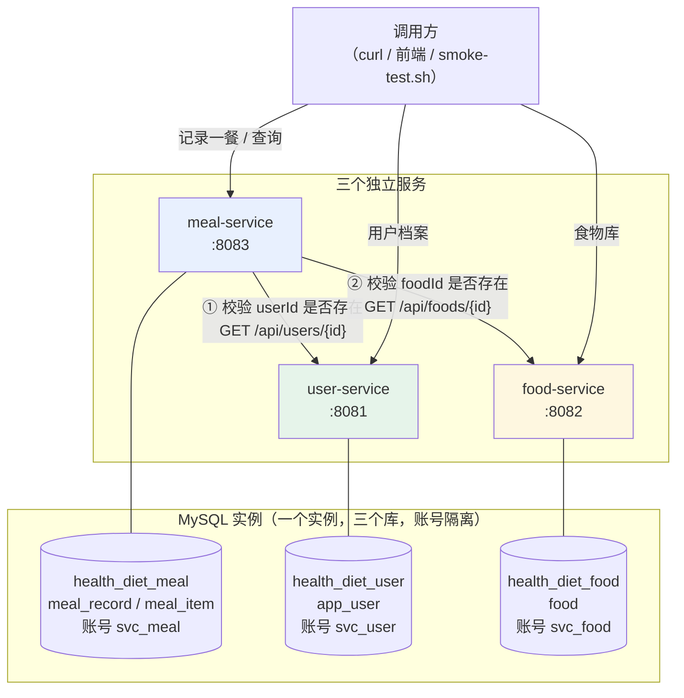
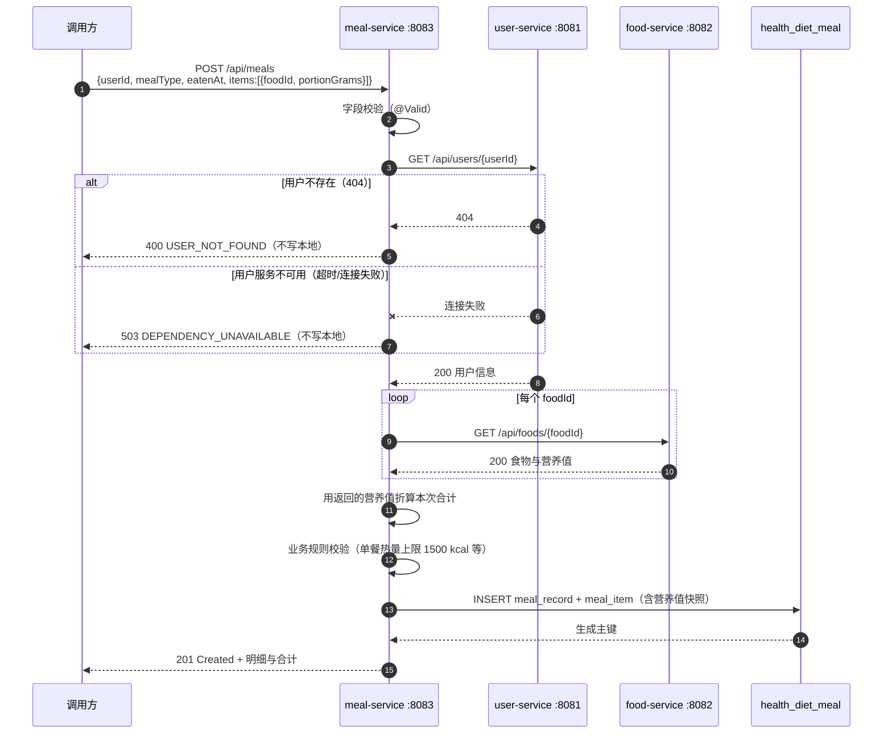

# 微服务拆分设计

> 项目：个人健康饮食记录管理系统 · 学号 2412190233 · 姓名 郑俊豪
> 本文对应第 06 周"服务拆分设计"，说明单体模块如何拆成微服务、各服务职责与数据归属、
> 服务间调用关系，以及拆分后新出现的问题与处理方式。

---

## 一、拆分原则

拆分不是"把代码按文件夹分开放"，而是按**数据归属**与**变更原因**切边界。本项目遵循四条：

| 原则 | 说明 |
| :--- | :--- |
| **一个服务只拥有自己的数据** | 每个服务一个独立数据库，只读写自己的表；跨服务只保存对方的主键 ID |
| **不建跨库外键** | 外键约束只在服务内部存在；跨服务的引用由应用层校验（调用对方接口） |
| **不直接调用对方的 Repository** | 服务之间只通过 HTTP API 通信，进程与数据库都是隔离的 |
| **边界对齐"谁在变"** | 用户规则、食物营养数据、饮食记录这三块的变更原因不同，因此拆开 |

> 保留 `monolith/` 作为单体版本不做改动，`services/` 下新建的每个工程都是**独立可启动**的
> Spring Boot 应用，共享仓库根目录的 `compose.yaml`、`scripts/`、`docs/`。

---

## 二、单体模块 → 微服务 的映射

第 04 周的单体应用里有三块业务，边界本来就比较清楚：

| 单体中的模块（Week 04） | 包含的类 | 拆分去向 | 拆分理由 |
| :--- | :--- | :--- | :--- |
| 食物库 | `Food`、`FoodRepository`、`FoodService`、`FoodController` | **food-service** | 营养基准数据，读多写少，被"记录"依赖但没有反向依赖 |
| 用户（原为 `MealRecord.eater` 字符串 + 无独立表） | — | **user-service**（本轮新建） | 拆出独立用户档案与每日热量目标；饮食记录只存 `user_id` |
| 饮食记录 | `MealRecord`、`MealItem`、`MealRecordService`、`MealController`、`NutritionCalculator` | **meal-service** | 记录是高频写入的业务数据，且是唯一需要"跨服务校验"的一环 |
| 日报汇总 | `DailySummaryService` | 留在 meal-service | 只依赖自己的数据，暂时不需要独立服务 |

**没有拆出去的部分**（如实说明）：`DailySummaryService` 仍在 meal-service 内，
因为它只读饮食记录自己的表；若后续要做跨用户的分析报表，再单独拆 `analysis-service`。
本轮按作业要求拆出 3 个服务，已达到"至少 3 个"。

---

## 三、三个服务的职责、端口与数据归属

| 服务 | 端口 | 独立数据库 | 拥有的表 | 职责 |
| :--- | :--- | :--- | :--- | :--- |
| **user-service** | 8081 | `health_diet_user` | `app_user` | 用户档案、每日热量目标；对外提供"用户是否存在"查询 |
| **food-service** | 8082 | `health_diet_food` | `food` | 食物库与每 100 克营养基准值；对外提供"食物是否存在/营养值"查询 |
| **meal-service** | 8083 | `health_diet_meal` | `meal_record`、`meal_item` | 记录一餐、折算营养、按用户与日期查询 |

数据库账号也各自独立（`svc_user` / `svc_food` / `svc_meal`），各自只被授权访问自己的库。
三个库建在**同一个 MySQL 实例**里（作业允许），但通过授权隔离：
`svc_meal` 无法读 `health_diet_user` 或 `health_diet_food` —— 想拿数据只能走 HTTP。

### 各服务的表结构要点

**user-service · `app_user`**

| 字段 | 说明 |
| :--- | :--- |
| `id` | 主键 |
| `username` | 唯一，登录名 |
| `display_name` | 显示名 |
| `daily_target_kcal` | 每日目标热量 |
| `created_at` | 创建时间 |

**food-service · `food`**（沿用 Week 04 设计）

| 字段 | 说明 |
| :--- | :--- |
| `id` / `name`（唯一）/ `category` | 基本属性 |
| `calories_per_100g` 等四项 | 每 100 克营养基准值 |

**meal-service · `meal_record` + `meal_item`**

| 表 | 关键字段 | 说明 |
| :--- | :--- | :--- |
| `meal_record` | `id`、`user_id`、`meal_type`、`eaten_at`、`note` | **`user_id` 只是普通列，没有外键** —— 用户数据在另一个库 |
| `meal_item` | `id`、`meal_record_id`（外键→本方 `meal_record`）、`food_id`、`portion_grams` | **`food_id` 只是普通列**，食物在另一个库 |

营养合计不落库，仍在读取时按 `food_id` 从 food-service 取基准值折算 —— 但为了避免
"一次查询打 N 次 HTTP"，meal-service 记录时会把当时的营养值**快照**存进 `meal_item`。
这是拆分带来的一个必要妥协，详见第六节。

---

## 四、服务之间的调用关系



**依赖方向是单向的**：`meal-service → user-service`、`meal-service → food-service`。
user 与 food 互不依赖，也不反向依赖 meal。因此 user/food 可以独立启动与升级，
只有 meal 需要另外两个服务可用。

### 唯一的一条跨服务业务流程

`POST /api/meals`（记录一餐）是本周要求的"跨服务业务流程"：



**失败处理的两条硬规则**（作业明确要求）：

1. **依赖资源不存在** → 返回 400 且**不写本地库**（不是"先写了再说"）；
2. **依赖服务不可用** → 返回 503 且**不写本地库**，绝不"跳过校验继续写"。

---

## 五、服务发现与地址解析（第 07 周更新）

### 5.1 从"固定地址"到"注册中心发现"

第 06 周的做法是把地址写在配置里（`USER_SERVICE_URL` / `FOOD_SERVICE_URL`）。
这样虽然能跑，但地址是**部署时写死的**：服务换 IP、扩容成多实例、容器重建后 IP 变化，
都要改配置重启，本质上还是"人工维护地址表"。

第 07 周接入 Nacos 后改为**按服务名发现**：

| 项目 | 第 06 周（固定地址） | 第 07 周（服务发现） |
| :--- | :--- | :--- |
| 地址来源 | `application.yml` 里的固定 URL | 向 Nacos 查询服务名的当前实例列表 |
| 服务换 IP | 要改配置重启 | 自动跟随，无需改配置 |
| 多实例 | 不支持（写死一个地址） | 天然支持（能拿到列表，本周取第一个） |
| 下线感知 | 只能等连接失败 | Nacos 摘除实例后立即查不到 |
| 配置项 | `USER_SERVICE_URL`、`FOOD_SERVICE_URL` | **已删除**，只剩超时配置 |

### 5.2 注册配置（三个服务一致）

```yaml
spring:
  application:
    name: user-service          # ← Nacos 里的服务名，三个服务各自不同
  cloud:
    nacos:
      discovery:
        server-addr: ${NACOS_SERVER_ADDR:localhost:8848}
        username: ${NACOS_USERNAME:nacos}
        password: ${NACOS_PASSWORD:}
        namespace: ${NACOS_NAMESPACE:}
        group: ${NACOS_GROUP:PERSONAL_GROUP}
        register-enabled: ${NACOS_REGISTER_ENABLED:true}
        enabled: ${NACOS_DISCOVERY_ENABLED:true}
```

| 服务 | `spring.application.name`（= Nacos 服务名） | 端口 |
| :--- | :--- | ---: |
| user-service | `user-service` | 8081 |
| food-service | `food-service` | 8082 |
| meal-service | `meal-service` | 8083 |

**分组统一为 `PERSONAL_GROUP`**：参与调用的三个服务必须在同一命名空间 + 同一分组，
否则 `DiscoveryClient.getInstances()` 查不到对方的实例。命名空间默认用 `public`，
自定义时填的是**命名空间 ID** 而不是名称。

### 5.3 寻址组件

业务代码不直接依赖 Spring Cloud 的 `DiscoveryClient`，而是抽一层自己的接口：

```java
public interface ServiceInstanceResolver {
    /** 服务名 → http://ip:port；查不到实例时抛 DependencyUnavailableException（503） */
    String resolveBaseUrl(String serviceName);
}
```

| 实现 | 用途 |
| :--- | :--- |
| `DiscoveryServiceInstanceResolver` | 生产用：包装 `DiscoveryClient`，每次调用都向注册中心现查 |
| `TestDiscoveryConfig` 里的桩 | 测试用：固定返回 `http://localhost:18081` / `18082`，不连 Nacos |

这样做有三个好处：

1. **避免 Bean 歧义** —— Spring Cloud 在关闭 Nacos 时会同时注册
   `compositeDiscoveryClient` 与 `simpleDiscoveryClient` 两个 primary 的 `DiscoveryClient`，
   直接注入会报"多于一个 primary bean"；
2. **测试干净** —— 替换一个自己的接口，比顶掉 `DiscoveryClient` 破坏 Spring Cloud 装配要安全；
3. **可换实现** —— 将来换 Eureka / Consul 只改这一层。

### 5.4 为什么不缓存实例地址

每次调用都向 `DiscoveryClient` 查一次（Nacos 客户端内部有本地缓存，开销很小），
而不是启动时查一次就存起来：

- 实例会上下线、换 IP、扩容；
- 缓存地址意味着"对方重启后本服务还往老地址发请求"，而且这种错误只在对方重启后暴露；
- 多一次本地查询换来地址始终正确，这笔账是划算的。

本周**只要求取一个实例完成调用**，不做轮询 / 权重 / 重试 / 熔断（作业明确不要求）。

### 5.5 超时仍然保留

无论地址从哪来，`RestTemplate` 的默认超时都是**无限**的。
某个依赖卡住不响应会占满请求线程，进而拖垮整个服务 —— 这是拆分后最典型的连锁故障。
因此 `HttpClientConfig` 里仍然显式设置连接超时 2 秒、读取超时 3 秒，并可用环境变量覆盖。

---

## 六、拆分带来的新问题（如实记录）

这是本次作业要求说明的重点。拆成微服务不是"更简单"，而是把原来一次数据库事务内的操作，
变成了跨网络的多步操作，因此多出下面这些窗口。

### 6.1 "远端成功、本地失败"窗口

在校验阶段，`user-service` 与 `food-service` 都已经成功返回了。
但如果接下来 `INSERT` 本地 `meal_record` 时失败（连接抖动、唯一约束冲突、磁盘满……），
就会出现：**对方的查询成功了，本地却没有留下记录**。

- 客户端看到的是一个错误（500 / 数据库异常），不会误以为成功；
- 但由于没有分布式事务，无法自动回滚"已经查过的校验动作"（校验本身无副作用，所以实际不需要回滚）；
- **本接口可以安全重试**：因为写入失败时本地什么都没留下，重试不会产生重复数据。

真正需要关注的是相反方向：**本地成功、远端状态已变**，见 6.2。

### 6.2 TOCTOU：校验通过后对方数据被删

`meal-service` 校验时用户存在，但在写入之前用户被删除（或食物被下线），
于是记录里存了一个**指向已不存在用户的 `user_id`**。

- 本轮**不做补偿**（作业明确不要求跨服务原子事务、自动补偿或消息机制）；
- 处理方式是"接受最终一致"：该记录仍能落库，查询时 `meal-service` 不保证能补全用户名；
- 如果以后需要强一致，正确的方向是引入**消息 + 重试/对账**，或改成"用户删除时发事件、meal 侧软删除引用"。

### 6.3 营养数据快照 vs 实时查询

拆库之后，`meal_item` 只知道 `food_id`，营养值在 food-service。
若每次查询都去取，一条记录有 N 种食物就要 N 次 HTTP；日报表更是 N×M 次。
因此在**记录时**把当时的营养值快照进 `meal_item`：

- 优点：查询只需读本地库，性能与可用性都不受 food-service 影响；
- 代价：食物库后来改了营养值，历史记录仍显示旧值。
  对"饮食记录"这个场景，**历史时刻的营养值本来就应是当时的值**，因此快照反而更符合业务语义。

### 6.4 一条记录的完整性依赖两个外部服务

`meal-service` 的记录接口在 user 与 food 都可用时才工作。这降低了可用性
（原本单体里只需数据库可用）。缓解方向：缓存食物库、或在 food 不可用时降级为
"只记录 foodId + 份量，营养值留空"，但本轮不做降级，宁可直接报错也不写入不完整的数据。

---

## 七、与单体版本的对照

| 维度 | 单体（Week 04/05） | 微服务（Week 06） |
| :--- | :--- | :--- |
| 部署单元 | 1 个 | 3 个（可独立启动/升级） |
| 数据库 | 1 个库 3 张表 | 3 个库，账号隔离 |
| 跨模块调用 | 直接方法调用 | HTTP（RestTemplate）+ 超时配置 |
| 数据一致性 | 单库事务 | 最终一致（本轮不做分布式事务） |
| 失败面 | 数据库不可用 | 数据库或任一依赖服务不可用 |
| 复杂度来源 | 代码组织 | 网络、超时、部分失败 |
| 启动方式 | `docker compose up`（1 应用 + 1 库） | `docker compose up`（3 应用 + 1 实例 3 库） |

**结论**：这次拆分在本项目里是合理的 —— 三块业务的变更原因不同、数据不互相写、
只有一处需要跨服务校验。但它确实用"网络调用的复杂度"换来了"独立部署与数据隔离"，
不是一个无条件的改进。
