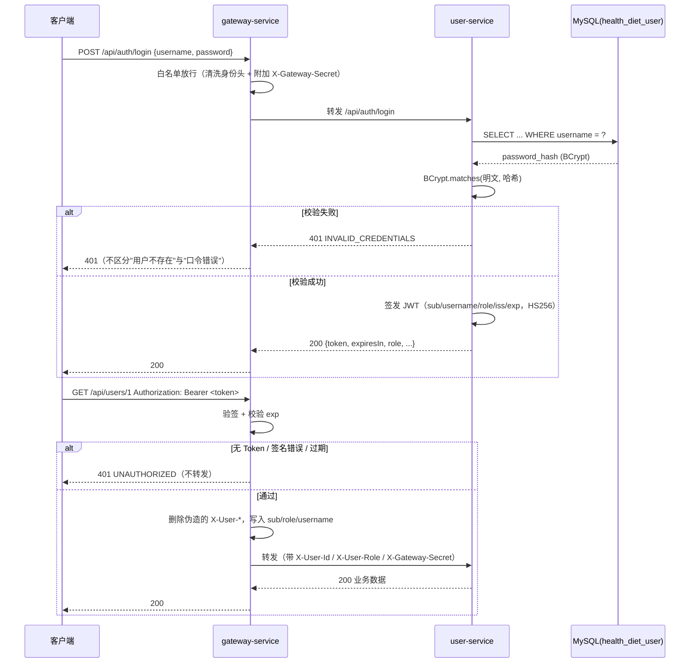

# 安全设计（第 09 周更新）

> 本文记录系统的**信任边界、认证流程、角色权限、网关路由表**，
> 以及在当前实现下已经覆盖 / 尚未覆盖的安全风险。
> 相关代码：`services/gateway-service`、`services/user-service`、`scripts/auth-test.sh`。

---

## 1. 信任边界

```
                 ┌─────────────────────────── 不可信：客户端 ───────────────────────────┐
                 │  任意请求头（包括 X-User-Id / X-User-Role）、任意 Token 内容           │
                 └───────────────────────────────┬──────────────────────────────────────┘
                                                 │ 只暴露 8080
                                    ┌────────────▼────────────┐
                                    │   gateway-service :8080  │  ← 唯一的认证/授权点
                                    │  清洗头 → 验签 → 授权    │
                                    └────────────┬────────────┘
                                                 │ 注入 X-User-* + X-Gateway-Secret
              ┌──────────────────────────────────┼──────────────────────────────────┐
              │                                  │                                  │
     ┌────────▼────────┐              ┌──────────▼─────────┐              ┌─────────▼────────┐
     │ user-service    │              │ food-service       │              │ meal-service     │
     │ :8081 (×2 实例) │              │ :8082 (×2 实例)    │              │ :8083            │
     └─────────────────┘              └────────────────────┘              └──────────────────┘
              ▲                                                                   │
              └───────────────── OpenFeign 内部调用（不经网关、不带用户 Token）─────┘
```

三条原则：

1. **身份只由网关产生**：下游只信任 `X-User-*`，而这些头只能由网关写入；
2. **客户端输入永远被覆盖**：网关先删除同名头，再写入验签结果；
3. **服务间调用是"系统身份"**：meal-service 调 user/food 时代表系统自身，
   不传递终端用户 Token（当前这些查询接口本身就是公开的业务校验接口）。

---

## 2. 认证流程



关键顺序：

- **清洗在前，判断在后**。否则"带一个 ADMIN 头"就能骗过角色检查。
- **401 先于 403**。没登录时不该暴露"这个接口需要什么角色"。
- **拒绝时直接写响应**，不把请求转发给下游，减少无谓的后端压力与日志噪音。

---

## 3. 角色与权限矩阵

| 角色 | 含义 | `/api/auth/login` | `/api/users/**` | `/api/foods/**` | `/api/meals/**` | `/api/admin/**` |
|---|---|---|---|---|---|---|
| （匿名） | 未登录 | ✅ | ❌ 401 | ❌ 401 | ❌ 401 | ❌ 401 |
| `USER` | 普通用户 | ✅ | ✅ | ✅ | ✅ | ❌ 403 |
| `NUTRITIONIST` | 营养师 | ✅ | ✅ | ✅ | ✅ | ❌ 403 |
| `ADMIN` | 管理员 | ✅ | ✅ | ✅ | ✅ | ✅ 200 |

当前是**接口级**授权（能不能访问这类接口），还没有数据级授权
（例如"用户只能看自己的饮食记录"）。这是下一步要补的。

---

## 4. 网关路由表

| 路由 ID | 断言 | 目标（服务名） | Token | 角色 |
|---|---|---|---|---|
| `auth-route` | `Path=/api/auth/**` | `lb://user-service` | 不需要 | — |
| `user-route` | `Path=/api/users/**` | `lb://user-service` | 需要 | 任意已认证 |
| `admin-route` | `Path=/api/admin/**` | `lb://user-service` | 需要 | `ADMIN` |
| `food-route` | `Path=/api/foods/**` | `lb://food-service` | 需要 | 任意已认证 |
| `meal-route` | `Path=/api/meals/**` | `lb://meal-service` | 需要 | 任意已认证 |

非业务入口：

| 路径 | 认证 | 说明 |
|---|---|---|
| `/api/health` | 公开 | 网关状态 + Nacos 已注册服务 |
| `/actuator/health` | 公开 | 容器健康探针 |

---

## 5. 威胁与措施

### 5.1 已覆盖

| 威胁 | 场景 | 措施 | 验证 |
|---|---|---|---|
| 未授权访问 | 不带 Token 调业务接口 | 网关返回 401，不转发 | `auth-test.sh` 场景 1 |
| Token 伪造/篡改 | 改 payload、改签名 | HS256 验签失败 → 401 | 场景 5 |
| Token 过期 | 使用过期 Token | `NimbusJwtDecoder` 校验 `exp` → 401 | 单元测试 / 手工 |
| 越权访问 | USER 调管理接口 | 网关按 `role` 返回 403 | 场景 4 |
| 身份头伪造 | 客户端加 `X-User-Role: ADMIN` | 网关先 `remove` 再 `set`；脚本验证 401/403 | 场景 1、4 |
| 绕过网关直连 | 直接访问 user-service 并伪造角色头 | `AdminController` 校验 `X-Gateway-Secret`（仅网关持有），失败 403 `GATEWAY_REQUIRED`；比较用 `MessageDigest.isEqual` | 单元测试 + 手工 |
| 口令明文存储/泄露 | 数据库被读 | 只存 BCrypt（随机盐，成本 10），响应 DTO 不含哈希 | 场景 7 + 单元测试 |
| 账号枚举 | 用登录接口试探用户名 | 用户不存在与口令错误返回同一个 401 | 单元测试 |
| 弱密钥 | `JWT_SECRET` 太短 | 启动时校验 ≥32 字节，不满足直接失败 | 单元测试 / 启动日志 |

### 5.2 尚未覆盖（明确写出来，避免"看起来安全"）

| 风险 | 现状 | 建议 |
|---|---|---|
| 传输明文 | 本机 HTTP；容器间 Docker 内网 | 生产在入口做 TLS 终止，强制 HTTPS |
| 无吊销机制 | Token 到期前一直有效 | 短 TTL + refresh token，或 Redis 黑名单 |
| 无速率限制 | 登录接口可被暴力尝试 | 网关按 IP/账号限流（Redis + Lua） |
| 无审计日志 | 只有应用日志 | 记录登录成功/失败、越权事件到独立审计库 |
| 数据级授权 | 任何已认证用户可查询任意 `{id}` | 校验 `X-User-Id` 与资源归属 |
| 下游端口仍发布 | 8081/8082/8083 映射到宿主机，便于联调 | 生产只发布 8080，其余 `expose` |
| 对称密钥 | 验签方也能签发 | 多签发方场景改 RS256/ES256 |

---

## 6. 密钥与配置管理

| 变量 | 使用者 | 要求 |
|---|---|---|
| `JWT_SECRET` | user-service（签发）、gateway-service（验签） | ≥32 字节；两边完全一致；**只在 `.env`** |
| `JWT_TTL_SECONDS` | user-service | 默认 3600 |
| `GATEWAY_SECRET` | gateway（写入）、user-service 管理接口（校验） | 随机串；**只在 `.env`** |

- `.env` 已被 `.gitignore` 忽略，仓库里只有 `.env.example` 的占位符；
- compose 用 `${JWT_SECRET:?...}` 强制要求，缺变量时拒绝启动，而不是悄悄用默认值；
- `application.yml` 里的默认值仅用于本地开发，README 已注明不是真实密钥。
